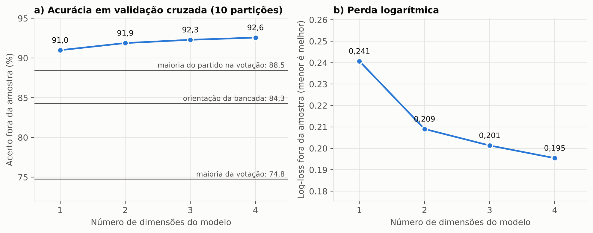
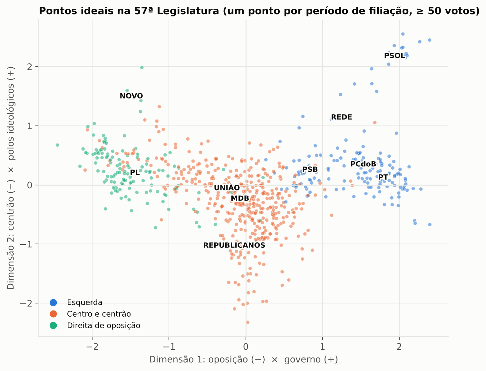
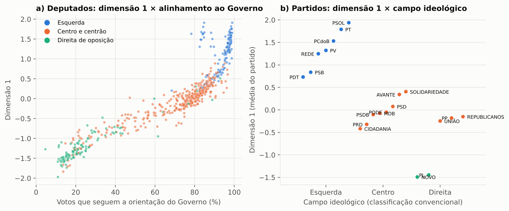
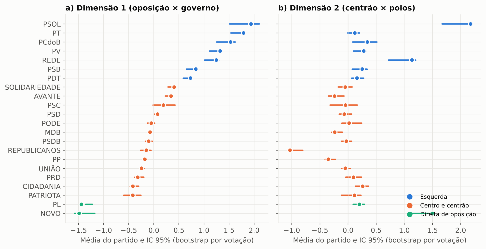
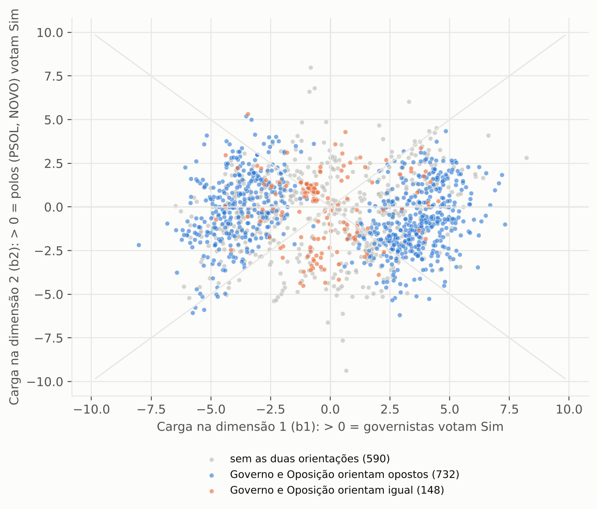
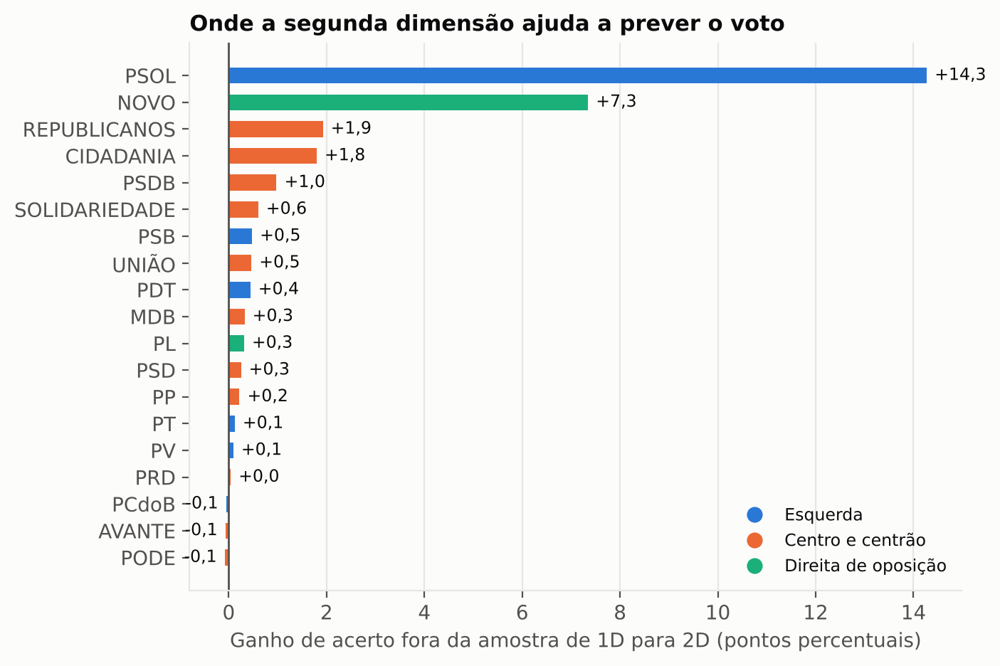
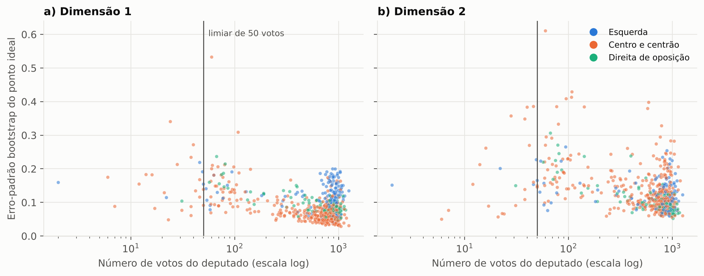
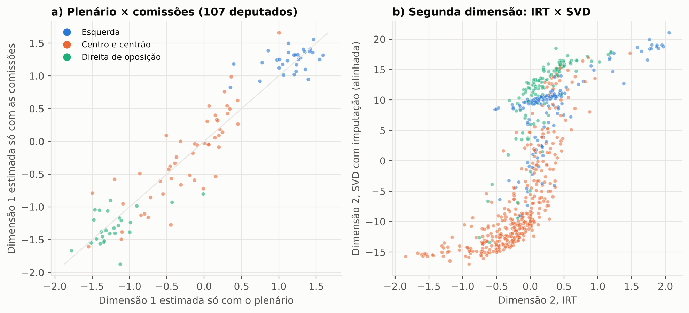

# Além de um eixo só: duas dimensões para explicar o voto nominal na Câmara dos Deputados no governo Lula 3

**Autoria:** [a preencher]
**Data desta versão:** novembro de 2026
**Código e dados:** `artigos/01-pontos-ideais/analise.py` (todos os números, tabelas e figuras deste texto saem desse script, a partir de `dados/leg57/`)

---

## Resumo

Os votos nominais na Câmara dos Deputados durante o terceiro governo Lula podem ser explicados por um eixo único, de governo × oposição ou de esquerda × direita, como sugere a literatura brasileira? Argumentamos que não. Estimamos pontos ideais de 644 deputados a partir de 433.476 votos em 1.470 votações nominais da 57ª Legislatura (março de 2023 a novembro de 2026), com um modelo logístico bilinear multidimensional (IRT 2PL, família IDEAL/NOMINATE), máxima verossimilhança penalizada e pontos que podem mudar quando o deputado troca de partido. Os critérios de decisão para as hipóteses foram fixados num documento de desenho redigido por um revisor metodológico que não consultou os valores dos resultados; o autor da análise já conhecia resultados preliminares e uma primeira execução completa, e por isso os testes não equivalem a um pré-registro. Em validação cruzada de dez partições, o modelo de duas dimensões acerta 91,9% dos votos fora da amostra, contra 84,3% da orientação da bancada e 88,5% da maioria do próprio partido na mesma votação. A primeira dimensão é predominantemente governo × oposição: dentro da direita, PP, Republicanos e União ficam perto do centro, entre 1,2 e 1,3 unidade do PL, e o alinhamento à orientação do Governo explica 83% da variância da dimensão, contra 60% do campo ideológico. Ela não é, porém, governo × oposição pura, porque o campo ideológico ainda acrescenta 9 pontos de R². A segunda dimensão é estável e não se reduz a um efeito "ferradura" de um eixo único: ela capta a dissidência dos dois polos programáticos, PSOL e NOVO (juntos ou separadamente), em votações de consenso amplo entre PT, centrão e boa parte do PL, sobretudo em matérias institucionais e fiscais, e não se reproduz quando o modelo é estimado só com as votações das comissões. Pelo critério fixado, duas dimensões não bastam: uma terceira melhora a previsão de forma pequena, mas mensurável, e é menos estruturada por partido que as duas primeiras. As coordenadas individuais acrescentam 3,4 pontos percentuais à maioria do partido, e a segunda dimensão é decisiva para explicar o voto dos partidos programáticos: sem ela, o modelo erra 14 pontos a mais nos votos do PSOL e 7 nos do NOVO. Explicar o voto sob Lula 3 exige, portanto, ao menos duas dimensões, e a segunda não é a ideológica que a literatura costuma contrapor ao governismo.

**Palavras-chave:** pontos ideais; votações nominais; dimensionalidade; Câmara dos Deputados; governo Lula 3.

## Abstract

Can roll-call voting in the Brazilian Chamber of Deputies under Lula's third government be explained by a single government–opposition or left–right axis, as the Brazilian literature suggests? We argue it cannot. We estimate ideal points for 644 deputies from 433,476 votes on 1,470 roll calls of the 57th Legislature (March 2023–November 2026), using a multidimensional bilinear logistic model (2PL IRT, IDEAL/NOMINATE family) fitted by penalized maximum likelihood, with legislator positions allowed to shift when a deputy switches parties. Decision criteria were set in a design document written by a methodological reviewer blind to the result values; the analyst already knew preliminary results and a first full run, so the tests are not a pre-registration. In ten-fold cross-validation, the two-dimensional model correctly predicts 91.9% of held-out votes, against 84.3% for the party-bloc whip and 88.5% for the majority of the deputy's own party on the same roll call. The first dimension is predominantly government versus opposition: within the right, PP, Republicanos and União sit near the centre, 1.2 to 1.3 units away from PL, and alignment with the government whip explains 83% of its variance against 60% for ideological camp. It is not purely government–opposition, however: ideological camp still adds 9 points of R². The second dimension is stable and is not a one-dimensional "horseshoe" artefact. It captures dissent by the two programmatic poles, PSOL and NOVO (jointly or separately), from broad agreements between PT, the centrão and much of PL, mainly on institutional and fiscal bills, and it is not recovered when the model is fitted to committee votes alone. By the pre-set criterion, two dimensions are not enough: a third yields a small but measurable predictive gain and is less party-structured than the first two. Individual coordinates add 3.4 percentage points over the party majority, and the second dimension is decisive for the programmatic parties: without it, the model makes 14 more percentage points of errors on PSOL votes and 7 on NOVO votes. Explaining votes under Lula 3 thus requires at least two dimensions, and the second is not the ideological one the literature usually sets against government–opposition.

**Keywords:** ideal points; roll-call votes; dimensionality; Brazilian Chamber of Deputies; Lula's third government.

---

## 1. Introdução

Como explicar os votos dos deputados federais durante o terceiro governo Lula? A Câmara que tomou posse em fevereiro de 2023 reuniu um governo de esquerda sem maioria própria, uma oposição de direita numerosa e organizada em torno do PL e um bloco amplo de partidos de centro e centro-direita (o "centrão"), parte dele com ministérios. A literatura brasileira oferece duas respostas para esse tipo de pergunta, e as duas são unidimensionais. Numa, o plenário se ordena da esquerda à direita, e o voto reflete a posição ideológica dos partidos. Na outra, o plenário se ordena pela relação de cada partido com o Executivo, e o voto reflete o pertencimento à base de governo ou à oposição. Sob Lula 3, as duas leituras se confundem, porque esquerda e governo quase coincidem.

O argumento deste artigo é que nenhuma das duas leituras basta para explicar o voto no período, e que a razão não é a esperada. A literatura que reconhece mais de um eixo costuma contrapor justamente o governismo e a ideologia como duas dimensões distintas. Na 57ª Legislatura, essas duas lógicas se fundem num mesmo eixo principal. Mas o voto não é unidimensional: há uma segunda dimensão, estável e substantiva, que separa os dois partidos com identidade programática mais marcada, PSOL e NOVO, dos acordos amplos que reúnem centrão, PT e boa parte do PL. Ignorá-la não muda muito a previsão do voto da maioria dos deputados, mas distorce a leitura dos partidos programáticos e a de um conjunto de votações decisivas.

O artigo responde a quatro perguntas, organizadas em torno da primeira:

- **RQ1.** Quantas dimensões são necessárias para explicar o voto nominal na 57ª Legislatura?
- **RQ2.** O que organiza a primeira dimensão: governo × oposição ou esquerda × direita?
- **RQ3.** O que é a segunda dimensão?
- **RQ4.** Quanto as posições individuais nessas dimensões acrescentam à orientação partidária na explicação do voto?

A estratégia de identificação para a RQ2 explora a única variação que discrimina as duas leituras unidimensionais: a que existe *dentro da direita*. PL e NOVO, de um lado, e PP, Republicanos e União, de outro, estão à direita em qualquer classificação convencional, mas apenas os primeiros fizeram oposição sistemática ao governo. Se o primeiro eixo for ideológico, esses partidos devem ficar juntos; se for governo × oposição, devem se separar.

O artigo faz três contribuições. A primeira é substantiva: mostra que o voto sob Lula 3 tem ao menos duas dimensões, que a primeira funde governismo e ideologia e que a segunda não é ideológica, mas opõe os polos programáticos aos acordos amplos do plenário, sobretudo em matérias institucionais e fiscais. A segunda é empírica: um retrato completo e reprodutível do espaço de votação da 57ª Legislatura, com a incerteza das posições quantificada. A terceira é metodológica: a escolha do número de dimensões e a comparação com a orientação partidária são feitas fora da amostra, com intervalos que respeitam a dependência entre votações da mesma matéria, e a segunda dimensão é submetida a um teste explícito contra a hipótese de ser só a curvatura de um eixo único (o efeito "ferradura").

**Nota de transparência.** As hipóteses e os critérios de decisão (Seção 4.5) foram formalizados num documento de desenho (`pipeline/fase1_blueprint_metodologico.md`, versionado no commit `7c95579`) por um revisor metodológico que não consultou os valores dos resultados. O autor da análise, porém, já conhecia resultados preliminares do projeto (a acurácia fora da amostra de 91,9% e a ordem dos partidos na primeira dimensão) e havia lido os resultados de uma primeira execução completa do script antes do commit do documento. Os testes não constituem, portanto, um pré-registro. Os desvios em relação ao desenho estão listados no Apêndice A. Relatamos os resultados contra os critérios fixados, inclusive quando eles não se sustentam, e marcamos como exploratórias as análises definidas depois de ver os dados.

O restante do texto está organizado assim: a Seção 2 revisa as leituras unidimensionais do voto e as ferramentas para medir mais de uma dimensão; a Seção 3 descreve os dados; a Seção 4, o modelo, a validação e as hipóteses; a Seção 5 apresenta os resultados; a Seção 6, a robustez e a incerteza; as Seções 7 a 9 discutem, listam limitações e concluem.

## 2. Uma ou mais dimensões?

### 2.1 Duas leituras unidimensionais do voto no Brasil

A literatura brasileira mudou a leitura do Legislativo nos anos 1990 ao mostrar que, ao contrário do que previam os diagnósticos de fragmentação e indisciplina, os partidos na Câmara votam de forma previsível e seguem as lideranças, e que o Executivo controla a agenda por meio de prerrogativas institucionais e da centralização dos trabalhos nos líderes (Figueiredo; Limongi, 1999; Limongi; Figueiredo, 1998). Ao testar explicações rivais, Cheibub, Figueiredo e Limongi (2009) encontraram nos partidos, e não nos governadores, o principal determinante do voto dos deputados. A pergunta que segue é o que organiza o conflito entre os partidos, e duas respostas convivem.

A primeira é ideológica. Para os anos FHC, Leoni (2002) estimou as posições dos deputados a partir das votações nominais e encontrou uma ordenação compatível com a escala esquerda–direita, com o PT num extremo e o PFL no outro. Para o governo Dilma, Scheeffer (2018) contrapôs ideologia e posição em relação ao governo e concluiu que a ideologia prevalece, exceto nas matérias que envolvem recursos financeiros, em que os partidos seguem o Executivo. Os surveys com legisladores, que medem a ideologia diretamente, descrevem a elite política brasileira numa escala única de esquerda–direita e indicam que o terceiro governo Lula começou com uma distância ideológica inédita entre o presidente e o Congresso (Zucco; Power, 2024).

A segunda é posicional. Zucco (2009) mostra que o comportamento nominal dos deputados se afasta de suas posições ideológicas declaradas na direção do presidente. Para o Senado entre 1989 e 2010, Izumi (2016) argumenta que uma única dimensão, de governo × oposição, basta para representar as preferências dos senadores. Em perspectiva comparada, Hix e Noury (2016) concluem que, na maioria dos legislativos, a divisão governo × oposição estrutura o voto mais que a posição dos partidos na escala esquerda–direita, embora esperem coalizões caso a caso ao longo de uma dimensão de políticas nos presidencialismos com governos de coalizão. E o apoio ao governo não se limita aos partidos com ministérios: aliados de fora do gabinete são decisivos para aprovar a agenda do Executivo (Assis; Silva, 2026).

As duas leituras têm em comum a premissa de que um eixo basta, e divergem sobre o que ele significa. O próprio desacordo indica que o significado do eixo depende de quanto a coalizão de governo coincide com um dos lados do espectro ideológico. Quando os dois coincidem, como sob Lula 3, um modelo de uma dimensão não consegue dizer qual das lógicas está operando, e qualquer conflito que não se alinhe a elas fica invisível.

### 2.2 Mais de uma dimensão: o que a literatura espera e o que ela não antecipa

A resposta usual a esse problema é tratar governismo e ideologia como duas influências distintas. Zucco e Lauderdale (2011) as separam com um survey auxiliar de legisladores, que ancora a posição ideológica e permite identificar o deslocamento produzido pelo partido e pelo Executivo. Scheeffer (2018) as faz competir em modelos de voto, matéria a matéria. Essa tradição espera, portanto, que um espaço de duas dimensões tenha um eixo de governismo e outro de ideologia.

Duas observações sobre o período sugerem que essa expectativa pode não se cumprir sob Lula 3. A primeira é a sobreposição já mencionada entre esquerda e governo, que tende a fundir as duas influências num eixo só. A segunda é a composição do sistema partidário. Os surveys de especialistas descrevem um deslocamento para a direita, a predominância de partidos orientados a cargos e votos mais que a políticas (Bolognesi; Ribeiro; Codato, 2023) e o esvaziamento do centro ideológico (Bolognesi et al., 2025), e a literatura sobre o "centrão" o caracteriza por demandas clientelistas, com a agenda ideológica em segundo plano (Testa; Mesquita; Bolognesi, 2024). Num plenário assim, é plausível que parte das votações não oponha esquerda e direita, nem governo e oposição, mas partidos com identidade programática forte a acordos amplos entre os demais. A literatura revisada não formula essa possibilidade como hipótese; ela foi sugerida pelos dados e é tratada aqui como interpretação a ser examinada, e não como teste confirmatório.

### 2.3 Como medir as dimensões do voto

O modelo espacial de votação supõe que cada legislador tem um ponto ideal num espaço de poucas dimensões e que cada votação separa duas alternativas nesse espaço. Poole e Rosenthal (1985) transformaram essa ideia num estimador, o NOMINATE, e mostraram que uma ou duas dimensões bastam para classificar corretamente a grande maioria dos votos no Congresso dos Estados Unidos (Poole; Rosenthal, 1997). A formulação estatística moderna trata o problema como um modelo de resposta ao item: a probabilidade de um "Sim" é uma função logística (ou probit) de um termo de dificuldade da votação e do produto entre a discriminação da votação e o ponto do legislador (Jackman, 2001; Clinton; Jackman; Rivers, 2004). Nessa formulação, o modelo é idêntico à fatoração de baixo posto de uma matriz binária com função de ligação, a mesma família de modelos usada em sistemas de recomendação (Koren; Bell; Volinsky, 2009).

Três problemas dessa literatura organizam as escolhas deste artigo. O primeiro é a identificação: a verossimilhança é invariante a translações, mudanças de escala e rotações do espaço latente, e as restrições que fixam esses graus de liberdade são escolhas do analista, não propriedades dos dados (Jackman, 2001; Bafumi et al., 2005). O segundo é a interpretação das dimensões: elas são construtos estatísticos, e seu significado político depende de validação externa e de atenção às votações que as definem (Bafumi et al., 2005). O terceiro é computacional: com centenas de milhares de votos, a estimação bayesiana por MCMC é lenta, o que motivou estimadores de máximo a posteriori e EM (Imai; Lo; Olmsted, 2016). Seguimos essa última via, com priors normais que funcionam como penalização, e quantificamos a incerteza por bootstrap. Para a pergunta central deste artigo, o ponto decisivo é que o número de dimensões seja escolhido pela capacidade de explicar votos que o modelo não viu, e não só pelo ajuste aos votos usados na estimação.

### 2.4 Lacuna e relação com os demais trabalhos do projeto

Até onde a busca alcançou (ver `pipeline/fase2_literatura.md`), não há estimativa publicada dos pontos ideais da 57ª Legislatura a partir das votações nominais; as posições disponíveis para o período vêm de surveys (Zucco; Power, 2024). A literatura tampouco examina se o voto sob Lula 3 é unidimensional, relata uma segunda dimensão que separe os partidos programáticos dos acordos amplos do plenário ou mede quanto as posições individuais acrescentam à informação partidária fora da amostra. Este artigo trata dessas lacunas.

Este artigo é o primeiro de um conjunto de sete trabalhos sobre a 57ª Legislatura construídos sobre a mesma base de dados. Os demais tratam da disciplina intrapartidária (Artigo 2), das trocas de partido (Artigo 3), da agenda temática das proposições (Artigo 4), das frentes parlamentares (Artigo 5), dos discursos (Artigo 6) e da fusão das várias representações dos deputados (Artigo 7). As coordenadas estimadas aqui são insumo para vários deles; por isso, a sua incerteza e a sua sensibilidade a escolhas de especificação recebem atenção detalhada.

## 3. Dados

Os dados vêm do portal de Dados Abertos da Câmara dos Deputados e cobrem a 57ª Legislatura de 1º de fevereiro de 2023 até a data da coleta (11 de novembro de 2026). No período, a Câmara registrou 43.631 votações, das quais apenas 1.604 (3,7%) tiveram votos nominais; as demais foram simbólicas e não deixam registro individual. Das votações nominais, 1.128 ocorreram no plenário e o restante em comissões, principalmente na Comissão de Constituição e Justiça e de Cidadania (CCJC).

A base bruta tem 473.323 registros de voto. Codificamos "Sim" como 1 e "Não" e "Obstrução" como 0 (a obstrução é um voto contra a matéria por meio da negação de quórum); abstenções, o voto do presidente da sessão ("Artigo 17") e registros vazios saem da análise. Seguindo a prática do NOMINATE, descartamos as votações em que a minoria teve menos de 2,5% dos votos, que quase não informam sobre posições relativas. A amostra final tem **433.476 votos de 644 deputados em 1.470 votações** (1.039 no plenário e 431 em comissões, das quais 276 na CCJC), entre 14 de março de 2023 e 4 de novembro de 2026. A matriz deputado × votação está preenchida em 35,5% das células (a ausência inclui licenças, suplências e votações em comissões das quais o deputado não é membro), e 56,7% dos votos são "Sim". A Tabela 1 mostra a distribuição por ano.

**Tabela 1.** Votações e votos analisados por ano.

| ano | votações | votos | votações no plenário | proporção de "Sim" |
|---|---|---|---|---|
| 2023 | 418 | 121.231 | 284 | 0,566 |
| 2024 | 403 | 102.967 | 242 | 0,565 |
| 2025 | 502 | 161.135 | 398 | 0,558 |
| 2026 | 147 | 48.143 | 115 | 0,605 |

*Fonte: elaboração própria a partir de Dados Abertos da Câmara (`tabelas/t1_dados_por_ano`).*

Cada voto vem acompanhado da orientação da bancada que representava o partido do deputado naquela data, buscada em cascata: a orientação do próprio partido; na falta dela, a da federação que o contém; na falta desta, a do bloco parlamentar. Em 66,7% dos votos há uma orientação utilizável (Sim, Não ou Obstrução); em 6,4% a liderança liberou a bancada e em 26,8% não houve orientação registrada. Há um problema de medida conhecido: a Câmara publica nomes de blocos abreviados e truncados, e os partidos que votaram sem orientação própria e fora de outra bancada foram atribuídos por inferência ao bloco truncado correspondente. Essa origem "bloco (inferido)" responde por 18,0% dos votos analisados e, entre os votos analisados com orientação utilizável, por 7,9% do total da amostra; a Seção 5.5 mostra que os resultados não dependem dela.

Para os testes da RQ2 usamos ainda duas informações. A primeira é a orientação do Governo em cada votação (registrada pela Câmara em 1.072 das 1.470 votações analisadas). A segunda é uma codificação ordinal grosseira do campo ideológico dos partidos: esquerda (PSOL, PCdoB, PT, PV, REDE, PSB, PDT), centro (MDB, PSD, PSDB, Cidadania, Podemos, Solidariedade, Avante, PRD) e direita (PL, NOVO, Missão, PP, Republicanos, União). A codificação segue a classificação convencional da literatura (por exemplo, Bolognesi; Ribeiro; Codato, 2023) e é deliberadamente simples: não usamos escores numéricos de surveys de especialistas, cujos valores não pudemos conferir na fonte para esta versão. O ponto decisivo do teste não depende de nuances dessa escala, porque os cinco partidos de direita que importam para a identificação estão à direita em qualquer classificação usual.

## 4. Método

### 4.1 Modelo

Seja $y_{ij} \in \{0, 1\}$ o voto do legislador $i$ na votação $j$. O modelo é

$$
\Pr(y_{ij} = 1) = \sigma\!\left(a_j + \mathbf{b}_j^{\top}\mathbf{x}_i\right), \qquad \sigma(z) = \frac{1}{1 + e^{-z}},
$$

em que $\mathbf{x}_i \in \mathbb{R}^K$ é o ponto ideal, $a_j$ é o intercepto (a "facilidade") da votação e $\mathbf{b}_j \in \mathbb{R}^K$ é o vetor de discriminação, cuja direção indica que conflito a votação mobiliza e cuja norma indica com que nitidez ela separa os legisladores. É o modelo 2PL multidimensional da teoria de resposta ao item e coincide, a menos da função de ligação, com o modelo de utilidade quadrática de Clinton, Jackman e Rivers (2004).

Como 171 deputados votaram por mais de um partido durante a legislatura, a unidade de análise é o *período de filiação* (deputado × partido), com

$$
\mathbf{x}_{i} = \mathbf{u}_{d(i)} + \boldsymbol{\delta}_{i},
$$

em que $\mathbf{u}_d$ é a posição do deputado e $\boldsymbol{\delta}_i$ é um desvio específico do período, fortemente penalizado. Há 831 períodos, dos quais 707 com pelo menos 50 votos.

A estimação é por máximo a posteriori com priors normais independentes, isto é, minimizamos

$$
-\sum_{(i,j)} \ell(y_{ij}; a_j, \mathbf{b}_j, \mathbf{x}_i)
+ \lambda_a \sum_j a_j^2 + \lambda_b \sum_j \lVert\mathbf{b}_j\rVert^2
+ \lambda_x \sum_d \lVert\mathbf{u}_d\rVert^2 + \lambda_\delta \sum_i \lVert\boldsymbol{\delta}_i\rVert^2,
$$

com $\lambda_a = 0{,}01$, $\lambda_b = 0{,}04$, $\lambda_x = 1$ e $\lambda_\delta = 4$, por L-BFGS com gradiente analítico. As penalizações resolvem a indeterminação de escala entre $\mathbf{b}$ e $\mathbf{x}$ e evitam a divergência dos parâmetros de votações perfeitamente separáveis.

### 4.2 Identificação e orientação dos eixos

A verossimilhança é invariante a rotações de $\mathbf{x}$ compensadas em $\mathbf{b}$. Fixamos a rotação depois da estimação: centralizamos os pontos dos 621 deputados com pelo menos 50 votos e os giramos para os seus eixos principais, de modo que a dimensão 1 é a de maior variância entre deputados. O sinal da dimensão 1 é escolhido de forma que valores positivos correspondam a deputados que seguem mais a orientação do Governo; o da dimensão 2, de forma que o PSOL tenha média positiva. Note-se que o uso do alinhamento ao Governo fixa apenas o *sinal* do eixo, e não a sua direção no plano, que vem da análise de componentes principais; a Seção 5.2 trata a possível circularidade remanescente.

### 4.3 Validação fora da amostra e comparações

A escolha do número de dimensões e a comparação com a informação partidária são feitas por validação cruzada em dez partições aleatórias das células (votos) da matriz. Cada modelo é reestimado sem os votos da partição de teste e avaliado neles por acurácia (proporção de votos classificados corretamente com o limiar de 0,5), perda logarítmica e a média geométrica das probabilidades atribuídas ao voto observado (GMP). Calculamos também a redução proporcional do erro (APRE) em relação à previsão de que todos votam com a maioria da votação.

Os comparadores são: (i) a maioria da votação; (ii) a orientação da bancada do deputado, quando houver, e a maioria da votação nos demais casos; (iii) a maioria do próprio partido naquela votação, calculada só com os votos de treino; (iv) um modelo 2D em que todos os deputados de um partido compartilham um único ponto; (v) modelos de 1 a 4 dimensões; e (vi) um modelo de uma dimensão com termo quadrático por votação, $\sigma(a_j + b_j x_i + c_j x_i^2)$, que representa a utilidade de proximidade num eixo único e serve de teste contra a hipótese de que a segunda dimensão seja um artefato de "ferradura".

Uma advertência importa para a RQ4. A validação por células é uma tarefa de *interpolação*: o modelo prevê o voto de um deputado numa votação usando os votos dos colegas na mesma votação, enquanto a orientação da bancada é dada antes do voto. A diferença entre o IRT e a orientação é, por isso, um limite superior do que as coordenadas acrescentam. O comparador simétrico é a maioria do partido na votação, que usa a mesma informação dos colegas.

Os intervalos de confiança das diferenças de desempenho são obtidos por bootstrap das proposições (as 1.470 votações se agrupam em 664 matérias, com várias votações por matéria): reamostramos as proposições com reposição 1.000 vezes e recalculamos a diferença média nos votos de teste.

### 4.4 Incerteza das posições e robustez

A incerteza dos pontos é estimada por bootstrap por proposição com 200 réplicas. Cada réplica reamostra as 664 proposições, reajusta o modelo a partir de valores iniciais aleatórios e aplica o mesmo procedimento de rotação e orientação da estimativa principal, sem girar a réplica em direção à estimativa pontual. Duas correções são necessárias. Primeiro, o ângulo da rotação de Procrustes que levaria cada réplica à estimativa pontual é registrado como diagnóstico da estabilidade dos eixos. Segundo, como a escala latente só é identificada pelos priors, a reamostragem (que duplica votações) dá mais peso aos dados frente ao prior de $\mathbf{b}$, as cargas crescem e os pontos encolhem; cada réplica é, por isso, recentrada e reescalada por um único fator isotrópico para ter a mesma variância total da estimativa pontual entre os deputados com pelo menos 50 votos. O fator mediano foi 1,09 (percentis 5 e 95: 1,06 e 1,11).

A robustez é avaliada com reestimações que variam: as penalizações ($\lambda_x$, $\lambda_b$ e $\lambda_\delta$ multiplicadas e divididas por fatores entre 4 e 16), o corte de votações desiguais (sem corte e cortes de 5%, 10% e 20%) e o tratamento da obstrução (como ausência) e da abstenção (como "Não"). Para que as acurácias sejam comparáveis entre especificações com amostras diferentes, a partição de teste é definida por uma função de hash de cada célula, e reportamos também a acurácia nas 31.229 células de teste comuns a todas as especificações. Estimamos ainda o modelo separadamente no plenário, nas comissões, na CCJC e em cada ano, e comparamos o IRT com uma decomposição em valores singulares (SVD) da matriz de votos codificada em ±1, com e sem imputação iterativa dos ausentes.

### 4.5 Hipóteses e critérios de decisão

Os critérios abaixo foram fixados no documento de desenho (ver a nota de transparência na Introdução). Reproduzimos os essenciais.

- **H1 (RQ2).** O eixo principal é governo × oposição. *H1a:* PP e Republicanos ficam, na dimensão 1, significativamente mais governistas que o PL (intervalos de 95% acima de zero), e a direita do centrão fica a pelo menos um terço do caminho entre a direita de oposição e a esquerda (refutada se algum intervalo incluir zero ou se a fração for ≤ 0,10; "misto" entre 0,10 e 0,33). Acrescentamos a União ao teste, o que o torna mais exigente. *H1b:* o alinhamento ao Governo explica a dimensão 1 além do campo ideológico (ganho de R² ≥ 0,10), mas o campo não acrescenta mais de 0,05 de R² ao alinhamento; dentro da direita, a correlação entre dimensão 1 e alinhamento é ≥ 0,5. *H1c:* com os pontos estimados só nas votações de índice par e o alinhamento medido só nas de índice ímpar, a correlação é ≥ 0,80, e a da dimensão 2 com o alinhamento tem módulo ≤ 0,30. *H1d:* tratar a obstrução como ausência não altera a dimensão 1 (r ≥ 0,95). A afirmação "o eixo principal é governo × oposição" exige H1a e H1c e que H1b e H1d não sejam refutadas.
- **H2 (RQ1).** *H2a:* duas dimensões são necessárias (ganho de 1D para 2D ≥ 0,3 ponto percentual, positivo em todas as partições, com log-loss menor e intervalo por proposição que exclua zero). *H2b:* duas dimensões são suficientes (ganho de 2D para 3D < 0,3 ponto ou menor que um terço do ganho de 1D para 2D); se não forem, a resposta à RQ1 passa a ser três dimensões. *H2c:* o ganho de 1D para 2D é positivo em todas as especificações de robustez, em todos os anos e no plenário isolado. *H2d:* o IRT 2D supera a maioria do partido na votação, com intervalo por proposição que exclua zero.
- **H3 (RQ3, estabilidade).** A segunda dimensão é estável: rotação dos eixos entre réplicas ≤ 15° no percentil 95, confiabilidade ≥ 0,70 e correlação mediana entre réplicas ≥ 0,90.
- **E1 (RQ3, exploratória).** Quatro leituras rivais da segunda dimensão: (a) ferradura de um eixo único; (b) polos programáticos contra o centro; (c) conflito procedimental sobre a agenda; (d) poucas matérias específicas.
- **H4 (RQ4).** Estimandos de magnitude, sem limiar de sucesso: ganho do IRT 2D sobre a maioria do partido (estimando principal) e sobre a orientação (limite superior), e acerto entre os votos dissidentes.

## 5. Resultados

### 5.1 Quantas dimensões? (RQ1)

A Tabela 2 resume a validação cruzada. Um único eixo já leva o acerto de 74,8% (todos votam com a maioria) para 91,0%, uma redução proporcional do erro de 64%. A segunda dimensão acrescenta 0,90 ponto percentual (intervalo de 95% por proposição: 0,72 a 1,09), positivo nas dez partições, e reduz a perda logarítmica de 0,241 para 0,209. H2, na parte da necessidade, se sustenta.

**Tabela 2.** Desempenho fora da amostra (validação cruzada, 10 partições).

| modelo | acurácia | dp entre partições | APRE | log-loss | GMP |
|---|---|---|---|---|---|
| Maioria da votação | 0,7477 | 0,0025 | 0,000 | 0,531 | 0,588 |
| Orientação da bancada | 0,8429 | 0,0026 | 0,378 | — | — |
| Maioria do partido na votação | 0,8848 | 0,0020 | 0,543 | 0,419 | 0,658 |
| IRT 2D, um ponto por partido | 0,8801 | 0,0026 | 0,525 | 0,303 | 0,739 |
| IRT 1D | 0,9098 | 0,0016 | 0,643 | 0,241 | 0,786 |
| IRT 1D quadrático | 0,9097 | 0,0016 | 0,642 | 0,229 | 0,795 |
| IRT 2D | 0,9188 | 0,0015 | 0,678 | 0,209 | 0,811 |
| IRT 3D | 0,9229 | 0,0017 | 0,694 | 0,201 | 0,818 |
| IRT 4D | 0,9256 | 0,0013 | 0,705 | 0,195 | 0,823 |

*Nota: APRE em relação à maioria da votação. A orientação não produz probabilidades, por isso não tem log-loss nem GMP. Fonte: `tabelas/t2_validacao_cruzada`.*

A suficiência de duas dimensões, por outro lado, **não** se sustenta pelo critério fixado. A terceira dimensão acrescenta 0,41 ponto percentual (intervalo: 0,30 a 0,51), ou 46% do ganho da segunda, acima do limite de um terço; a quarta acrescenta mais 0,28 ponto. A curva da Figura 1 não tem um "cotovelo" nítido depois de duas dimensões: os ganhos decrescem, mas continuam positivos. Dentro da amostra, as conclusões são as mesmas (APRE de 0,650, 0,693, 0,717 e 0,737 para 1 a 4 dimensões). A SVD da matriz de votos dá a mesma imagem por outro caminho: o primeiro valor singular responde por 38,5% da variância da matriz codificada, o segundo por 9,1% e o terceiro por apenas 1,9%.

**Figura 1.** Acurácia (a) e perda logarítmica (b) fora da amostra segundo o número de dimensões. Barras de erro: desvio-padrão entre as dez partições. Linhas horizontais: comparadores sem pontos ideais.

H2c e H2d também se sustentam: o ganho de 1D para 2D é positivo em todas as especificações de robustez, em todos os anos e no plenário isolado (Seção 6), e o IRT 2D supera a maioria do partido com intervalo que exclui zero (Seção 5.5). Pelo critério fixado, porém, a resposta à RQ1 é **três dimensões**. Mantemos o modelo de duas dimensões como especificação de trabalho no restante do artigo, o que é um desvio do desenho (Apêndice A), por três razões: a terceira dimensão é pequena (autovalor de 0,14, contra 0,83 e 0,31), é menos estruturada por partido que as duas primeiras (Seção 5.4) e não altera as duas primeiras (correlações de 0,997 e 0,984 entre os modelos 2D e 3D). A terceira dimensão não deve, contudo, ser tratada como ruído.

### 5.2 O primeiro eixo: governo × oposição ou esquerda × direita? (RQ2)

A Figura 2 mostra o mapa dos pontos ideais e a Tabela 3 as médias por partido. A dimensão 1 responde por 74% da variância dos pontos entre deputados (autovalores 0,81 e 0,29) e vai do PL e do NOVO (médias −1,45 e −1,49) ao PT e ao PSOL (+1,79 e +1,94). Ela ordena a esquerda da forma esperada, mas a direita não: PP (−0,18), Republicanos (−0,15) e União (−0,25) ficam junto ao MDB e ao PSD, perto do zero, e muito longe do PL.

**Figura 2.** Pontos ideais na 57ª Legislatura (modelo 2D). Cada ponto é um período de filiação com pelo menos 50 votos; as cores indicam o grupo político (esquerda; centro e centrão; direita de oposição: PL, NOVO e Missão).

**Tabela 3.** Posições médias dos partidos (períodos de filiação com ≥ 50 votos; partidos com ≥ 3 períodos).

| partido | períodos | dim. 1 | dim. 2 | alinhamento ao Governo | campo |
|---|---|---|---|---|---|
| NOVO | 5 | −1,49 | 1,50 | 0,11 | direita |
| PL | 127 | −1,45 | 0,20 | 0,25 | direita |
| Patriota | 5 | −0,42 | 0,12 | 0,63 | — |
| Cidadania | 5 | −0,42 | 0,26 | 0,59 | centro |
| PRD | 7 | −0,32 | 0,10 | 0,52 | centro |
| União | 77 | −0,25 | −0,05 | 0,61 | direita |
| PP | 71 | −0,18 | −0,35 | 0,68 | direita |
| Republicanos | 64 | −0,15 | −1,03 | 0,73 | direita |
| PSDB | 22 | −0,10 | −0,03 | 0,67 | centro |
| MDB | 55 | −0,08 | −0,24 | 0,72 | centro |
| Podemos | 28 | −0,05 | 0,02 | 0,75 | centro |
| PSD | 66 | 0,08 | −0,07 | 0,75 | centro |
| PSC | 3 | 0,19 | −0,04 | 0,82 | — |
| Avante | 9 | 0,34 | −0,24 | 0,81 | centro |
| Solidariedade | 6 | 0,41 | −0,05 | 0,82 | centro |
| PDT | 21 | 0,73 | 0,16 | 0,90 | esquerda |
| PSB | 20 | 0,84 | 0,25 | 0,92 | esquerda |
| REDE | 6 | 1,25 | 1,14 | 0,90 | esquerda |
| PV | 8 | 1,32 | 0,28 | 0,97 | esquerda |
| PCdoB | 10 | 1,53 | 0,34 | 0,96 | esquerda |
| PT | 76 | 1,79 | 0,12 | 0,98 | esquerda |
| PSOL | 15 | 1,94 | 2,18 | 0,84 | esquerda |

*Nota: "alinhamento ao Governo" é a proporção de votos dos deputados do partido que seguiram a orientação do Governo, entre as votações em que ele orientou. Fonte: `tabelas/t5_partidos`.*

Os testes da Seção 4.5 dão o seguinte resultado (Tabela 4).

**Tabela 4.** Testes de H1 (dimensão 1 como governo × oposição).

| teste | estatística | estimativa | IC 95% (bootstrap) | critério | resultado |
|---|---|---|---|---|---|
| H1a | dim. 1: PP − PL | 1,27 | [1,12; 1,32] | > 0 | sustentado |
| H1a | dim. 1: Republicanos − PL | 1,30 | [1,09; 1,40] | > 0 | sustentado |
| H1a | dim. 1: União − PL (acréscimo ao desenho) | 1,20 | [1,08; 1,26] | > 0 | sustentado |
| H1a | fração do caminho até a esquerda | 0,42 | [0,38; 0,44] | ≥ 0,33 | sustentado |
| H1b | R² da dim. 1: só campo / só Governo / ambos | 0,60 / 0,83 / 0,92 | — | ganho do Governo ≥ 0,10 e ganho do campo ≤ 0,05 | não sustentado (ganho do campo = 0,09) |
| H1b | r(dim. 1, alinhamento) dentro da direita | 0,96 | [0,94; 0,96] | ≥ 0,5 | sustentado |
| H1c | r(dim. 1 nas votações pares, alinhamento nas ímpares); r da dim. 2 | 0,91; −0,24 | — | ≥ 0,80; \|r\| ≤ 0,30 | sustentado |
| H1d | r(dim. 1 padrão, dim. 1 com obstrução como ausência) | 0,999 | — | ≥ 0,95 | sustentado |

*Nota: intervalos percentílicos do bootstrap por proposição. As réplicas têm mais ruído que a estimativa pontual, o que atenua correlações e R²; por isso, em algumas estatísticas o intervalo fica abaixo da estimativa pontual e deve ser lido como conservador. Fonte: `resultados.json` (`bootstrap.h1_ic`, `recortes`, `robustez`).*

A separação dentro da direita é nítida e precisa. Os três partidos de direita que participaram do ministério ficam entre 1,2 e 1,3 unidade do PL na dimensão 1, e a direita do centrão fica a 42% do caminho entre a direita de oposição e a esquerda. Dentro do campo da direita, a correlação entre a dimensão 1 e o alinhamento à orientação do Governo é de 0,96 (Figura 3a). A associação não é um artefato de os mesmos votos definirem o eixo e o alinhamento: com os pontos estimados só nas votações de índice par e o alinhamento medido só nas de índice ímpar, a correlação é de 0,91 (e a da dimensão 2 com o alinhamento, de −0,24). Tampouco depende da codificação da obstrução.

**Figura 3.** (a) Dimensão 1 e proporção de votos que seguem a orientação do Governo, por deputado. (b) Média da dimensão 1 por partido segundo o campo ideológico.

O teste H1b, porém, não se sustenta pelo critério fixado. O alinhamento ao Governo explica 83% da variância da dimensão 1 entre deputados, e o campo ideológico, 60%; juntos, explicam 92%. O alinhamento acrescenta 33 pontos de R² ao campo, muito além do limiar, mas o campo também acrescenta 9 pontos ao alinhamento, acima do limite de 5 pontos que caracterizaria um eixo de governo × oposição "puro". Uma medida invariante à rotação aponta na mesma direção. No plano das duas dimensões, a direção que melhor prediz o alinhamento ao Governo forma um ângulo de 26° com o eixo 1 (intervalo: 21° a 31°), e a que melhor prediz o campo ideológico forma 36° (29° a 39°). O eixo 1 está mais perto da primeira, mas as duas direções não coincidem, e o eixo fica entre elas.

Há também uma evidência de que o conflito ideológico reaparece quando o conflito com o governo sai de cena. Nas 196 votações em que Governo e PL orientaram da mesma forma, um modelo estimado só com essas votações ainda ordena os partidos da esquerda à direita (PSOL +1,27, PT +0,61, PSB +0,16, centrão entre −0,22 e −0,03, PL −0,42 e NOVO −1,01), com o PL agora próximo do centrão e longe do NOVO (Tabela 5). Esse recorte foi definido depois de ver as cargas e é exploratório.

**Tabela 5.** Média da dimensão principal por partido em modelos estimados em recortes de votações (exploratório).

| recorte | votações | PSOL | PT | PSB | MDB | PSD | União | PP | Republicanos | PL | NOVO | r com dim. 1 completa | r com dim. 2 completa |
|---|---|---|---|---|---|---|---|---|---|---|---|---|---|
| Governo e PL orientam igual | 196 | 1,27 | 0,61 | 0,16 | −0,09 | −0,10 | −0,22 | −0,11 | −0,03 | −0,42 | −1,01 | 0,91 | 0,08 |
| Governo e PL orientam opostos | 609 | 1,27 | 1,19 | 0,61 | 0,01 | −0,01 | −0,20 | −0,11 | −0,07 | −1,05 | −1,02 | 0,99 | −0,03 |
| Governo e PSOL-REDE orientam opostos | 115 | −0,99 | 0,57 | 0,12 | 0,12 | 0,05 | −0,11 | 0,10 | 0,22 | −0,54 | −0,62 | 0,68 | −0,58 |

*Fonte: `tabelas/t7b_recortes_orientacao`.*

H1a, H1c e H1d se sustentam; H1b não se sustenta, porque o campo ideológico acrescenta mais poder explicativo do que o limite fixado. A regra agregada do desenho exige que H1b "não seja refutada", mas o desenho não definiu um limiar de refutação para H1b; interpretamos o resultado como não sustentado, mas não refutado (o alinhamento ao Governo ainda domina, e dois dos três critérios de H1b passam), e por isso adotamos a formulação atenuada que o próprio desenho prevê para resultados mistos. Essa é uma decisão de interpretação, registrada no Apêndice A. A resposta à RQ2 é, assim: **o primeiro eixo é predominantemente governo × oposição, com um componente ideológico.** Em termos práticos, a dimensão 1 mede sobretudo a distância de cada deputado em relação ao governo, mas, entre dois deputados com o mesmo grau de alinhamento ao Governo, o de esquerda tende a ter valor maior (mais governista) na dimensão 1: numa regressão da dimensão 1 no alinhamento e no campo, o coeficiente da esquerda em relação ao centro é de +0,74, e o da direita, de −0,04.

### 5.3 A segunda dimensão (RQ3)

**Estabilidade (H3).** A segunda dimensão é estável. Nas 200 réplicas de bootstrap (todas convergiram), os eixos giram no máximo 4,2° em relação à estimativa pontual (mediana de 1,0° e percentil 95 de 2,7°). A confiabilidade da dimensão 2, medida como a fração da variância entre deputados que não é erro de estimação, é de 0,92 (0,99 na dimensão 1), e a correlação mediana entre a dimensão 2 de cada réplica e a estimativa pontual é de 0,96. A razão entre os dois autovalores é de 2,8, longe da faixa em que a ordem dos eixos ficaria ambígua. A dimensão 2 também resiste às variações de especificação (correlação mínima de 0,97 com a estimativa padrão, no corte de minoria de 20%). H3 se sustenta.

**Quem está em cada polo.** No alto da dimensão 2 estão o PSOL (+2,18) e o NOVO (+1,50), seguidos da REDE (+1,14); embaixo estão Republicanos (−1,03) e PP (−0,35), com MDB (−0,24) e Avante (−0,24). PT (+0,12) e PL (+0,20) ficam perto do zero. As diferenças que definem o eixo são precisas: PSOL − PT = 2,06 (intervalo: 1,70 a 2,34), NOVO − PL = 1,29 (0,98 a 1,44) e Republicanos − PP = −0,68 (−0,89 a −0,44) (Figura 4).

**Figura 4.** Médias dos partidos nas duas dimensões, com intervalos de 95% do bootstrap por proposição (200 réplicas).

**Não é uma ferradura (E1a).** Uma possibilidade conhecida é que um espaço de uma dimensão com utilidade de proximidade, em que os dois extremos votam juntos contra o meio, apareça num modelo bilinear como uma segunda dimensão em forma de U. A assinatura descritiva prevista no desenho está presente: uma regressão da dimensão 2 no quadrado da dimensão 1 tem R² de 0,29 (acima do limiar de 0,25), com coeficiente positivo. Mas o teste preditivo decisivo rejeita essa leitura. O modelo de uma dimensão com termo quadrático por votação tem a mesma acurácia que o linear (diferença de −0,01 ponto, intervalo de −0,11 a 0,16) e só melhora a perda logarítmica, enquanto o modelo de duas dimensões o supera em 0,90 ponto (0,73 a 1,08). A segunda dimensão não é a curvatura de um eixo único. Além disso, o PL, que é um dos extremos da dimensão 1, fica perto do zero da dimensão 2: os "polos" da segunda dimensão são o PSOL e o NOVO, não os extremos em geral.

**Que votações a definem (E1b–d).** Em 372 das 1.470 votações (25%), a carga na dimensão 2 é maior que a carga na dimensão 1. A Tabela 6 compara essas votações com as demais, e a Figura 5 mostra as cargas.

**Tabela 6.** Perfil das votações dominadas por cada dimensão (diferenças absolutas médias entre as proporções de "Sim" dos grupos, em pontos percentuais).

| grupo | votações | % no plenário | % com Governo = Oposição | minoria média (%) | PSOL × PT | NOVO × PL | PSOL × NOVO | PT × PL | centrão × PT |
|---|---|---|---|---|---|---|---|---|---|
| dim. 2 dominante | 372 | 89,5 | 55,7 | 16,6 | 46,1 | 43,5 | 51,4 | 34,3 | 18,8 |
| dim. 1 dominante | 1.098 | 64,3 | 7,7 | 28,9 | 2,7 | 12,7 | 89,7 | 88,5 | 45,7 |

*Nota: "centrão" = PP, Republicanos, União, MDB e PSD. "% com Governo = Oposição": entre as votações em que ambos orientaram. Fonte: `tabelas/t8a_perfil_dim2`.*

**Figura 5.** Cargas das votações nas duas dimensões. Votações em que Governo e Oposição orientaram de forma oposta (azul) se espalham ao longo do eixo horizontal; aquelas em que orientaram igual (laranja) se concentram perto de b1 = 0, isto é, na dimensão 2.

Nas votações dominadas pela dimensão 1, PSOL e PT votam juntos (diferença de 2,7 pontos), assim como, em menor grau, NOVO e PL, e esquerda e direita de oposição se separam quase totalmente. Nas votações dominadas pela dimensão 2, PT e centrão votam juntos (18,8 pontos de diferença), enquanto PSOL e NOVO se afastam dos seus vizinhos de campo (46 e 44 pontos). Em mais da metade dessas votações, Governo e Oposição orientaram da mesma forma, e a minoria é menor (16,6% contra 28,9%). Contando, em cada votação, de que lado ficou a maioria de cada grupo (343 votações de dimensão 2 dominante com todos os grupos presentes), o PT vota com o centrão em 89% delas e o PL em 78%, contra 70% e 36% nas votações de dimensão 1 dominante. Os dois polos, porém, nem sempre dissentem juntos: a diferença média entre PSOL e NOVO ainda é de 51 pontos, e os dois votam juntos contra o centrão em 37% das votações de dimensão 2 dominante (contra 0,7% nas de dimensão 1); em 22% só o PSOL se separa, e em 29% só o NOVO (`resultados.json`, `dim2.coalizoes_*`). A assinatura prevista no desenho para a leitura "polos contra o centro" (PSOL e NOVO próximos entre si nessas votações) não se cumpre, portanto, em sentido estrito. A dissidência de algum dos polos em relação ao centrão, isoladamente, não distingue as duas dimensões (ocorre em 87% das votações de dimensão 2 dominante e em 91% das de dimensão 1). O que distingue a dimensão 2 é a amplitude do consenso, que inclui PT, centrão e boa parte do PL, e a dissidência conjunta dos dois polos, muito mais frequente nela. A dimensão 2 não é procedimental: os requerimentos de retirada de pauta e adiamento, instrumentos típicos da obstrução, são as votações em que ela menos domina (8,5%), enquanto propostas de emenda à Constituição e projetos de lei complementar são as em que mais domina (42% e 43%) (`tabelas/t8b`, `t8c`). Tampouco é um tema isolado: as votações de dimensão 2 dominante se espalham por 213 proposições, e as dez mais frequentes respondem por 22% delas.

As matérias com as maiores cargas na dimensão 2 incluem a PEC 9/2023 (anistia a sanções aplicadas a partidos), o PLP 175/2024 (execução de emendas parlamentares), o PLP 93/2023 e o PLP 210/2024 (regime fiscal), a reforma tributária (PEC 45/2019 e PEC 31/2007), o PL 4438/2023 (legislação eleitoral) e a PEC 3/2021 (prerrogativas parlamentares) (`tabelas/t8d`, `t8_top_dim2`). A composição do consenso varia de matéria para matéria: na PEC 3/2021, o PT ficou do lado dos polos (entre 12% e 18% de "Sim" nas votações de maior carga, contra 79% a 92% do centrão e 94% a 100% do PL), e nas matérias fiscais parte do PL acompanhou os polos. Na aprovação da PEC 9/2023 em segundo turno, por exemplo, nenhum deputado do PSOL ou do NOVO votou "Sim", contra 95% do PT e 89% do centrão. São matérias de interesse institucional da classe política (financiamento e sanções partidárias, prerrogativas, controle do orçamento) e de política fiscal, em que se formam consensos amplos dos quais os dois partidos com identidade programática mais marcada tendem a se afastar.

A resposta à RQ3 é, portanto: **a segunda dimensão capta a dissidência dos polos programáticos (PSOL e NOVO, juntos ou separadamente) em relação a consensos amplos que reúnem o centrão, quase sempre o PT e com frequência o PL, em matérias institucionais e fiscais.** O rótulo "oposição ideológica × centrão", usado em versões anteriores do projeto, é impreciso em dois pontos: o PL, principal partido da oposição, não está no polo superior, e o PT, principal partido do governo, costuma estar do lado do centrão. Essa leitura é exploratória, no sentido de que os rótulos foram sugeridos pelos dados.

### 5.4 A terceira dimensão (exploratório)

Como H2 não sustentou a suficiência de duas dimensões, examinamos a terceira dimensão do modelo 3D. As duas primeiras dimensões desse modelo reproduzem as do 2D (correlações de 0,997 e 0,984), e a terceira é ortogonal a elas. Ela é pequena (autovalor de 0,14, contra 0,83 e 0,31) e domina a carga de apenas 12% das votações. É também menos estruturada por partido: no modelo 3D, o partido explica 47% da variância da terceira dimensão entre deputados, contra 77% na primeira e 60% na segunda (`tabelas/t14_dim3_partidos`). As médias partidárias vão do NOVO e do bloco MDB–PSDB–Republicanos–PSD (entre −0,43 e −0,28) ao PL (+0,36) e ao PDT (+0,59), com grande variação interna (desvio-padrão de 0,41 no PP e no PDT). As votações que mais a definem são três votações da PEC 5/2023 (imunidade tributária de templos), a PEC 3/2021 e uma série de matérias tributárias de 2023 (MPV 1185/2023, PLP 153/2015, PEC 293/2004) (`tabelas/t14b`). Não arriscamos um rótulo: a terceira dimensão parece capturar divisões transversais aos partidos em temas religiosos e tributários específicos. Seu sinal é arbitrário.

### 5.5 O que as coordenadas acrescentam à orientação partidária (RQ4)

Os partidos são o principal organizador das posições: o partido explica 78% da variância da dimensão 1 entre deputados e 59% da dimensão 2. Mesmo assim, as posições individuais acrescentam informação à filiação. O IRT 2D acerta 3,4 pontos percentuais a mais que a maioria do próprio partido na mesma votação (intervalo: 2,9 a 3,9), o estimando simétrico principal, e 3,9 pontos a mais que um modelo 2D em que todos os deputados de um partido compartilham o mesmo ponto (3,4 a 4,3). Em relação à orientação da bancada, a diferença é de 7,6 pontos (6,7 a 8,6), mas esse número é um limite superior, pelas razões da Seção 4.3.

**Tabela 7.** Acurácia fora da amostra segundo a situação da orientação partidária.

| situação | votos | % | orientação | maioria | maioria do partido | IRT 1D | IRT 2D |
|---|---|---|---|---|---|---|---|
| orientada pelo partido | 70.146 | 16,2 | 0,910 | 0,566 | 0,912 | 0,920 | 0,927 |
| orientada pela federação | 68.401 | 15,8 | 0,982 | 0,739 | 0,978 | 0,959 | 0,982 |
| orientada pelo bloco | 116.420 | 26,9 | 0,860 | 0,856 | 0,868 | 0,905 | 0,909 |
| orientada pelo bloco (inferido) | 34.362 | 7,9 | 0,871 | 0,869 | 0,887 | 0,913 | 0,919 |
| bancada liberada | 27.934 | 6,4 | — | 0,672 | 0,792 | 0,787 | 0,806 |
| sem orientação | 116.213 | 26,8 | — | 0,736 | 0,852 | 0,908 | 0,913 |

*Fonte: `tabelas/t3_por_fonte_orientacao`.*

A Tabela 7 mostra onde está o ganho. Quando a orientação vem do próprio partido ou de uma federação, ela é quase tão boa quanto o IRT (98,2% de acerto para as federações, empatada com o IRT 2D). O ganho do IRT se concentra nos votos orientados por blocos, que são coalizões heterogêneas de vários partidos, e nos votos sem orientação. A origem "bloco (inferido)" não destoa da origem "bloco" registrada diretamente (acertos da orientação de 87,1% e 86,0%), o que indica que a inferência dos blocos truncados não distorce a comparação.

Nos votos com orientação, 90,2% seguiram a bancada. Nos 28.256 votos dissidentes, o IRT 2D acerta 55,0%, contra 50,3% do IRT 1D e 17,1% da maioria do partido. As coordenadas captam, portanto, uma parte da dissidência, mas apenas uma parte: mais de 45% dos votos contra a bancada continuam imprevisíveis a partir de posições estáveis, o que é compatível com dissidência motivada por fatores específicos da votação (base eleitoral, temas locais, negociações pontuais).

Por fim, a segunda dimensão importa para poucos partidos. O ganho de acerto de 1D para 2D é de 14,3 pontos entre os votos do PSOL e de 7,3 pontos entre os do NOVO, mas fica abaixo de 2 pontos em todos os demais partidos e abaixo de 0,5 ponto em PT, PL, PP, PSD e MDB (Figura 6). Para a maior parte do plenário, um único eixo de governo × oposição descreve o voto quase tão bem quanto dois.

**Figura 6.** Ganho de acerto fora da amostra de 1D para 2D, por partido (partidos com pelo menos 2.000 votos).

## 6. Robustez e incerteza

**Incerteza individual.** O erro-padrão bootstrap mediano dos pontos dos deputados com pelo menos 50 votos é de 0,09 na dimensão 1 e de 0,12 na dimensão 2 (percentil 90: 0,16 e 0,22), e é cerca do dobro na dimensão 1 e 40% maior na dimensão 2 para os deputados com menos votos (Figura 7). Como a dispersão dos pontos é muito maior (desvios-padrão de 0,90 e 0,54), a ordenação é precisa em termos agregados, mas não na posição exata de cada deputado: o intervalo de 95% da posição de um deputado no ranking da dimensão 1 cobre, na mediana, 65 posições entre 621. Em 19% dos deputados o intervalo da dimensão 1 inclui o zero, e em 46% o da dimensão 2. Classificações individuais do tipo "o deputado mais governista do partido X" devem, portanto, ser feitas com os intervalos (disponíveis em `tabelas/pontos_ideais_deputados.csv`).

**Figura 7.** Erro-padrão bootstrap dos pontos ideais segundo o número de votos do deputado.

**Regularização, cortes e obstrução.** A Tabela 8 mostra que nenhuma das doze variações altera de forma relevante os resultados. Nas células de teste comuns, a acurácia 2D fica entre 91,3% e 91,5% em todas as especificações; o ganho de 1D para 2D fica entre 0,8 e 1,0 ponto; as correlações com as dimensões da especificação padrão são de pelo menos 0,98 na dimensão 1 e 0,97 na dimensão 2. As penalizações mudam a *escala* dos pontos (o desvio-padrão da dimensão 1 vai de 0,37 a 1,43), como esperado num modelo identificado pelos priors, mas não a sua ordem.

**Tabela 8.** Robustez (partição de teste por hash; acurácia nas 31.229 células de teste comuns a todas as especificações).

| especificação | votações | acurácia 2D (células comuns) | ganho 1D→2D | r dim. 1 | r dim. 2 |
|---|---|---|---|---|---|
| padrão | 1.470 | 0,914 | 0,009 | 1,000 | 1,000 |
| λx = 0,25 | 1.470 | 0,914 | 0,009 | 0,998 | 0,996 |
| λx = 4 | 1.470 | 0,914 | 0,009 | 0,996 | 0,995 |
| λb = 0,01 | 1.470 | 0,914 | 0,009 | 0,999 | 0,997 |
| λb = 0,16 | 1.470 | 0,914 | 0,010 | 0,999 | 0,997 |
| λδ = 0,25 | 1.470 | 0,914 | 0,009 | 0,984 | 0,977 |
| λδ = 64 | 1.470 | 0,913 | 0,009 | 0,998 | 0,995 |
| sem corte de votações desiguais | 1.602 | 0,914 | 0,008 | 1,000 | 1,000 |
| corte de minoria em 5% | 1.379 | 0,914 | 0,009 | 1,000 | 0,999 |
| corte de minoria em 10% | 1.262 | 0,914 | 0,009 | 0,999 | 0,995 |
| corte de minoria em 20% | 1.055 | 0,915 | 0,008 | 0,998 | 0,974 |
| obstrução como ausência | 1.461 | 0,914 | 0,009 | 0,999 | 0,999 |
| obstrução e abstenção como "Não" | 1.470 | 0,914 | 0,009 | 1,000 | 0,999 |

*Fonte: `tabelas/t10_robustez`.*

**Plenário × comissões.** Estimado só com as votações do plenário, o modelo reproduz as duas dimensões do modelo conjunto (correlações de 0,999 nas duas, após alinhamento de Procrustes). Nas comissões, a imagem muda (Tabela 9). Entre os 107 deputados com pelo menos 50 votos nas comissões, a dimensão 1 estimada só com as comissões correlaciona 0,95 com a do plenário (Figura 8a), e a correlação persiste dentro dos partidos (0,72 nos resíduos em relação à média partidária). A dimensão 2, porém, não se reproduz (correlação de 0,29), e o modelo de duas dimensões não melhora a previsão em relação ao de uma dimensão nas comissões (92,6% contra 93,9%, numa única partição de teste de 10% dos votos, sem intervalo). No modelo conjunto, estimado com todas as votações, o ganho da segunda dimensão nos votos de comissão é pequeno: 0,3 ponto na CCJC (92,4% contra 92,1%) e nulo nas demais comissões (92,5% nos dois modelos) (`tabelas/t9a_cv_por_orgao`). A evidência indica que a segunda dimensão é sobretudo um fenômeno de plenário; uma explicação plausível, que não testamos, é que as PECs, os PLPs e as matérias de interesse institucional que a definem são decididos no plenário.

**Tabela 9.** Modelos estimados por órgão (validação com 10% dos votos).

| amostra | votações | votos | deputados ≥ 50 votos | maioria | orientação | IRT 1D | IRT 2D | r dim. 1 | r dim. 2 |
|---|---|---|---|---|---|---|---|---|---|
| só plenário | 1.039 | 417.902 | 618 | 0,750 | 0,843 | 0,910 | 0,919 | 0,999 | 0,999 |
| só comissões | 431 | 15.574 | 107 | 0,704 | 0,869 | 0,939 | 0,926 | 0,961 | 0,290 |
| só CCJC | 276 | 12.422 | 94 | 0,685 | 0,859 | 0,936 | 0,921 | 0,960 | 0,388 |

*Nota: correlações com o modelo conjunto, após alinhamento de Procrustes. Fonte: `tabelas/t9_plenario_comissoes`.*

**Figura 8.** (a) Dimensão 1 estimada só com o plenário e só com as comissões. (b) Dimensão 2 do IRT e da SVD com imputação iterativa.

**Ao longo do tempo.** Estimado ano a ano, o modelo reproduz a dimensão 1 da legislatura inteira com correlações entre 0,97 e 0,98 e a dimensão 2 com correlações entre 0,84 e 0,92; o ganho de 1D para 2D é positivo em todos os anos (de 0,2 ponto em 2026 a 1,5 ponto em 2024) (`tabelas/t13_por_ano`). A ordem dos partidos na dimensão 1 é estável, com o PL sempre no extremo da oposição e o PSOL, o PCdoB e o PT no extremo governista. Um ponto merece registro: a acurácia da orientação da bancada cai de 87% em 2023, 2024 e 2026 para 79% em 2025, enquanto a do IRT se mantém (`resultados.json`, `cv_por_ano`). Isso é compatível com a reorganização das bancadas e dos blocos naquele ano, mas não investigamos a causa.

**Método alternativo.** Uma SVD da matriz de votos com imputação iterativa dos ausentes acerta 91,0% fora da amostra em duas dimensões (89,4% sem imputação), contra 91,9% do IRT na mesma partição, e recupera bem a dimensão 1 (correlação de 0,97 com o IRT) e razoavelmente a dimensão 2 (0,75). A relação entre as dimensões 2 dos dois métodos é monotônica, mas não linear (Figura 8b), o que é esperado: a SVD trata os votos como contínuos e satura nos extremos. As conclusões sobre a dimensão 1 não dependem da forma logística do modelo; a dimensão 2 é recuperada de forma aproximada.

## 7. Discussão

A pergunta que orienta o artigo é se um eixo único explica o voto sob Lula 3. A resposta é não, e por razões diferentes das que a literatura antecipa.

**Governismo e ideologia se fundem no eixo principal.** As duas leituras unidimensionais estão parcialmente certas ao mesmo tempo. O eixo principal é predominantemente governo × oposição, o que converge com Zucco (2009), para quem o voto dos deputados se desloca na direção do presidente, com Izumi (2016), para o Senado, e com o padrão que Hix e Noury (2016) encontram na maioria dos legislativos. Partidos de direita que ocuparam ministérios ficam, nesse eixo, muito mais perto do PT do que do PL, e o alinhamento ao Governo explica a posição dos deputados de direita quase perfeitamente. Mas o eixo conserva um componente ideológico: o campo acrescenta poder explicativo ao alinhamento, e, quando o conflito com o governo sai de cena (nas votações em que Governo e PL orientam igual), a ordem esquerda–direita reaparece, como na leitura de Leoni (2002). Uma interpretação coerente com os dois achados é que o governismo dos partidos de centro e de direita é condicional, e que, num período em que esquerda e governo coincidem, as duas lógicas se projetam na mesma direção. Por isso, o modelo de duas dimensões não as separa em dois eixos, como a tradição de Zucco e Lauderdale (2011) e Scheeffer (2018) levaria a esperar. O resultado contraria, também, a expectativa de Hix e Noury (2016) para presidencialismos com governo de coalizão, em que previam coalizões caso a caso ao longo de uma dimensão de políticas.

**A segunda dimensão não é ideológica.** Ela não é um eixo "social" ortogonal ao econômico, nem um eixo procedimental de obstrução, nem a curvatura de um eixo único. Ela separa os dois partidos com identidade programática mais marcada, PSOL e NOVO, dos acordos amplos que se formam entre o centrão, o PT e, com frequência, o PL. A REDE, que divide uma federação com o PSOL, fica do mesmo lado; PT e PL ficam no meio da dimensão, cada um alternando de lado conforme a matéria. Essa dimensão se concentra em propostas de emenda à Constituição e projetos de lei complementar, em matérias institucionais e fiscais, e é um fenômeno sobretudo de plenário. Ela dialoga com a observação de Scheeffer (2018) de que, nas matérias que envolvem recursos financeiros, a lógica do apoio ao Executivo se sobrepõe à ideológica: sob Lula 3, é nesse tipo de matéria que mesmo a oposição de direita tende a se juntar ao consenso, e que os partidos programáticos se isolam. Por ser uma interpretação sugerida pelos dados, ela precisa ser examinada em outras legislaturas.

**Os partidos se encaixam nas duas dimensões de formas distintas.** A posição central de PP, Republicanos e União na primeira dimensão é o que se esperaria de partidos que os especialistas classificam à direita, mas como orientados a cargos e votos mais que a políticas (Bolognesi; Ribeiro; Codato, 2023; Testa; Mesquita; Bolognesi, 2024): o "centro" que desaparece nos surveys de especialistas (Bolognesi et al., 2025) reaparece no voto, como centro de governismo. Uma divergência merece registro: a caracterização de especialistas do "centrão" inclui o PL (Testa; Mesquita; Bolognesi, 2024), mas na 57ª Legislatura o PL vota no polo da oposição na primeira dimensão, longe dos partidos fisiológicos, e no meio da segunda. Na outra ponta, PSOL e NOVO, opostos na primeira dimensão, ficam do mesmo lado na segunda: a distância entre eles não é só ideológica, e a proximidade, não é só tática.

**Implicações para explicar o voto.** Para a maior parte do plenário, um eixo de governo × oposição explica o voto quase tão bem quanto dois. A segunda dimensão é decisiva para os partidos programáticos (ganho de 14 pontos no PSOL e de 7 no NOVO) e para as votações institucionais e fiscais que a definem. Para quem usa pontos ideais como medida de ideologia, a primeira dimensão de Lula 3 não deve ser lida como escala esquerda–direita: ela é sobretudo uma escala de governismo, e coloca PP e Republicanos no centro, o que é compatível com governismo, e não necessariamente com moderação ideológica. Para quem usa a orientação partidária como preditor, a orientação de partidos e federações é muito informativa, a de blocos bem menos, e é aí que as posições individuais mais acrescentam, o que é coerente com a centralidade dos líderes partidários (Limongi; Figueiredo, 1998; Cheibub; Figueiredo; Limongi, 2009).

## 8. Limitações

1. **Votações nominais são uma amostra selecionada.** Só 3,7% das votações da legislatura tiveram votos nominais. Votações nominais ocorrem por exigência regimental (PECs, PLPs) ou por pedido de verificação, o que tende a sobrerrepresentar matérias conflituosas e disputas de obstrução. Os pontos descrevem o espaço dessas votações, não o de toda a produção legislativa.
2. **Equivalência observacional entre esquerda e governo.** Sob Lula 3, a esquerda está no governo; a identificação da RQ2 vem só da variação dentro da direita (e, em menor grau, dentro da esquerda). O teste definitivo é replicar a análise numa legislatura em que governo e esquerda não coincidam, como a 56ª (2019–2022).
3. **Retrato estático.** O modelo estima uma posição por período de filiação para toda a legislatura. Mudanças de posição sem troca de partido (por exemplo, a saída de partidos da base do governo) só aparecem nas estimativas anuais, que são mais ruidosas.
4. **Medida da orientação.** 18,0% dos votos analisados têm orientação atribuída por inferência a blocos com nome truncado. A Tabela 7 indica que essa inferência não distorce os resultados, mas o erro de medida não é zero.
5. **Codificação da obstrução e das ausências.** A obstrução é tratada como "Não", e a ausência como dado faltante ignorável. Ausências estratégicas violam esse pressuposto. A robustez à codificação da obstrução foi verificada; a das ausências, não.
6. **Comissões.** A composição das comissões não é aleatória e só 107 deputados têm votos suficientes nelas; as comparações entre plenário e comissões são restritas a esse grupo.
7. **Partidos pequenos.** NOVO (5 períodos), REDE (6) e Missão (1 período; `estrutura.periodos_por_partido`) definem parte da interpretação da dimensão 2 com poucos deputados. Os intervalos do bootstrap levam isso em conta, mas a interpretação depende de um número pequeno de legisladores.
8. **Encolhimento e escala.** A estimação por máximo a posteriori encolhe os pontos de deputados com poucos votos em direção ao centro. A escala dos eixos depende das penalizações (Tabela 8), o que impede comparar magnitudes entre especificações ou com outros estudos sem padronização.
9. **Interpretação a posteriori.** Os rótulos das dimensões 2 e 3 foram sugeridos pelos dados; os testes que os sustentam (Tabela 5, Tabela 6) foram parcialmente definidos depois de ver as cargas.
10. **Ausência de pré-registro.** As hipóteses foram formalizadas por um revisor que não consultou os valores, mas o autor da análise já conhecia resultados preliminares e uma primeira execução completa. Elas não constituem um pré-registro.

## 9. Conclusão

O voto nominal na Câmara dos Deputados durante o terceiro governo Lula não se explica por um eixo único. A primeira dimensão funde as duas leituras unidimensionais da literatura: é predominantemente governo × oposição, separa a direita de oposição da direita que participou do governo e acompanha quase perfeitamente o alinhamento dos deputados à orientação do Executivo, mas conserva um componente ideológico. A segunda dimensão não é a ideológica que a literatura costuma contrapor ao governismo: ela capta a dissidência dos dois polos programáticos, PSOL e NOVO, em relação a acordos amplos entre o centrão, o PT e boa parte do PL, em matérias institucionais e fiscais votadas sobretudo no plenário. Pelo critério que fixamos, há ainda uma terceira dimensão, pequena e menos estruturada por partido. As posições individuais acrescentam alguns pontos percentuais à filiação partidária na explicação do voto, sobretudo onde a orientação vem de blocos heterogêneos.

Dois resultados contradizem leituras anteriores do próprio projeto e merecem destaque. Duas dimensões não bastam pelo critério fixado no desenho. E a segunda dimensão não é "oposição ideológica × centrão": o PT costuma estar do lado do centrão, e o PL, no meio. O próximo passo é replicar o desenho na 56ª Legislatura, em que o governo era de direita, para verificar se governismo e ideologia se separam em dois eixos quando deixam de coincidir e se a dimensão dos partidos programáticos reaparece.

## Apêndice A. Desvios em relação ao documento de desenho

O documento de desenho (`pipeline/fase1_blueprint_metodologico.md`, commit `7c95579`) fixou hipóteses, critérios e procedimentos. Registramos aqui o que foi feito de forma diferente.

1. **RQ1 (H2b).** O desenho previa que, se duas dimensões não fossem suficientes, a resposta à RQ1 passaria a ser três dimensões, com a terceira tratada como exploratória. Respondemos "três dimensões" e examinamos a terceira (Seção 5.4), mas mantivemos o modelo 2D como especificação de trabalho nas Seções 5.2, 5.3, 5.5 e 6, pelas razões da Seção 5.1.
2. **H1b e a regra agregada de H1.** O desenho definiu a condição para H1b ser sustentada, mas não para ser refutada. H1b não se sustenta (o campo acrescenta 0,09 de R² ao alinhamento, acima do limite de 0,05). Na regra agregada, tratamos esse resultado como "não sustentado, mas não refutado" e adotamos a formulação atenuada que o desenho previa para resultados mistos de H1a.
3. **H1a.** Acrescentamos a União ao teste, o que o torna mais exigente; o resultado não muda.
4. **Implementações posteriores ao desenho.** Os intervalos por proposição para os ganhos da validação cruzada, os intervalos bootstrap das estatísticas de H1 (incluindo União − PL), o ângulo entre direções reduzido a [0°, 90°] e a validação cruzada do modelo 1D quadrático foram implementados depois do documento de desenho, conforme as recomendações dele. O reescalonamento isotrópico das réplicas do bootstrap (Seção 4.4) foi introduzido depois de observar que os intervalos de algumas médias partidárias não continham a estimativa pontual; a causa é a identificação da escala apenas pelos priors (as réplicas saíram, em mediana, 9% menores, `bootstrap.fator_escala_mediano`).
5. **Análises não previstas.** As medidas de coalizão nas votações de dimensão 2 dominante (Seção 5.3), o exame da terceira dimensão (Seção 5.4) e os coeficientes da regressão conjunta da dimensão 1 (Seção 5.2) foram definidos depois de ver os resultados e são exploratórios.
6. **Critério E1(b).** A assinatura prevista para a leitura "polos contra o centro" pedia que PSOL e NOVO votassem de forma parecida nas votações de dimensão 2 dominante; ela não se cumpre (diferença média de 51 pontos). A interpretação da Seção 5.3 foi reformulada em função disso.

---

## Declarações

**Disponibilidade de dados e código.** Os dados são públicos (Dados Abertos da Câmara dos Deputados) e estão versionados no repositório do projeto em `dados/leg57/`. O script `artigos/01-pontos-ideais/analise.py` reproduz todos os números, tabelas e figuras; a execução completa leva cerca de 30 minutos em quatro núcleos. As posições de cada deputado, com erros-padrão e intervalos, estão em `tabelas/pontos_ideais_deputados.csv`.

**Ética.** A pesquisa usa apenas dados públicos e agregados sobre o exercício do mandato parlamentar (votos nominais), sem recrutamento de participantes nem dados pessoais sensíveis. Não houve submissão a comitê de ética, por não se tratar de pesquisa com seres humanos nos termos usuais.

**Contribuições (CRediT).** [a preencher pelos autores]

**Conflito de interesses.** Os autores declaram não haver conflito de interesses. [confirmar]

**Financiamento.** [a preencher]

**Uso de inteligência artificial.** A análise, o código e a redação deste manuscrito foram produzidos com o auxílio de um assistente de IA (Claude, da Anthropic) operando sobre o repositório do projeto, inclusive na revisão metodológica e na busca bibliográfica. Todas as referências foram conferidas em bases bibliográficas, e todos os números saem do script de análise. A responsabilidade pelo conteúdo é dos autores.

---

## Referências

ASSIS, Pedro Paulo de; SILVA, Glauco Peres da. Informal Coalitions in Action: Party Legislative Performance in Brazilian Presidentialism. **Brazilian Political Science Review**, v. 20, n. 1, e0001, 2026. DOI: 10.1590/1981-3821202600010001.

BAFUMI, Joseph; GELMAN, Andrew; PARK, David K.; KAPLAN, Noah. Practical Issues in Implementing and Understanding Bayesian Ideal Point Estimation. **Political Analysis**, v. 13, n. 2, p. 171–187, 2005. DOI: 10.1093/pan/mpi010.

BOLOGNESI, Bruno; RIBEIRO, Ednaldo; CODATO, Adriano. Uma nova classificação ideológica dos partidos políticos brasileiros. **Dados – Revista de Ciências Sociais**, v. 66, n. 2, e20210164, 2023. DOI: 10.1590/dados.2023.66.2.303.

BOLOGNESI, Bruno; RIBEIRO, Ednaldo; CODATO, Adriano; SILVA, Bruno Fernando da. O desaparecimento do centro ideológico no sistema partidário brasileiro. **Opinião Pública**, v. 31, e31120, 2025. DOI: 10.1590/1807-0191202531120.

CHEIBUB, José Antonio; FIGUEIREDO, Argelina Cheibub; LIMONGI, Fernando. Partidos políticos e governadores como determinantes do comportamento legislativo na Câmara dos Deputados, 1988-2006. **Dados – Revista de Ciências Sociais**, v. 52, n. 2, p. 263–299, 2009. DOI: 10.1590/S0011-52582009000200001.

CLINTON, Joshua; JACKMAN, Simon; RIVERS, Douglas. The Statistical Analysis of Roll Call Data. **American Political Science Review**, v. 98, n. 2, p. 355–370, 2004.

FIGUEIREDO, Argelina Cheibub; LIMONGI, Fernando. **Executivo e Legislativo na nova ordem constitucional**. Rio de Janeiro: Editora FGV, 1999.

HIX, Simon; NOURY, Abdul. Government-Opposition or Left-Right? The Institutional Determinants of Voting in Legislatures. **Political Science Research and Methods**, v. 4, n. 2, p. 249–273, 2016. DOI: 10.1017/psrm.2015.9.

IMAI, Kosuke; LO, James; OLMSTED, Jonathan. Fast Estimation of Ideal Points with Massive Data. **American Political Science Review**, v. 110, n. 4, p. 631–656, 2016. DOI: 10.1017/S000305541600037X.

IZUMI, Mauricio Yoshida. Governo e oposição no Senado brasileiro (1989-2010). **Dados – Revista de Ciências Sociais**, v. 59, n. 1, p. 91–138, 2016. DOI: 10.1590/00115258201672.

JACKMAN, Simon. Multidimensional Analysis of Roll Call Data via Bayesian Simulation: Identification, Estimation, Inference, and Model Checking. **Political Analysis**, v. 9, n. 3, p. 227–241, 2001. DOI: 10.1093/polana/9.3.227.

KOREN, Yehuda; BELL, Robert; VOLINSKY, Chris. Matrix Factorization Techniques for Recommender Systems. **Computer**, v. 42, n. 8, p. 30–37, 2009. DOI: 10.1109/MC.2009.263.

LEONI, Eduardo. Ideologia, democracia e comportamento parlamentar: a Câmara dos Deputados (1991-1998). **Dados – Revista de Ciências Sociais**, v. 45, n. 3, p. 361–386, 2002. DOI: 10.1590/S0011-52582002000300002.

LIMONGI, Fernando; FIGUEIREDO, Argelina Cheibub. Bases institucionais do presidencialismo de coalizão. **Lua Nova: Revista de Cultura e Política**, n. 44, p. 81–106, 1998. DOI: 10.1590/S0102-64451998000200005.

POOLE, Keith T.; ROSENTHAL, Howard. A Spatial Model for Legislative Roll Call Analysis. **American Journal of Political Science**, v. 29, n. 2, p. 357–384, 1985. DOI: 10.2307/2111172.

POOLE, Keith T.; ROSENTHAL, Howard. **Congress: A Political-Economic History of Roll Call Voting**. New York: Oxford University Press, 1997.

SCHEEFFER, Fernando. Ideologia e comportamento parlamentar na Câmara dos Deputados. **Teoria & Pesquisa: Revista de Ciência Política**, v. 27, n. 2, p. 167–188, 2018. DOI: 10.31068/tp.27208.

TESTA, Graziella; MESQUITA, Lara; BOLOGNESI, Bruno. Do fisiologismo ao centro do poder: as reformas eleitorais e o centrão 2.0. **Caderno CRH**, v. 37, e024003, 2024. DOI: 10.9771/ccrh.v37i0.55537.

ZUCCO, Cesar. Ideology or What? Legislative Behavior in Multiparty Presidential Settings. **The Journal of Politics**, v. 71, n. 3, p. 1076–1092, 2009.

ZUCCO, Cesar; LAUDERDALE, Benjamin E.. Distinguishing Between Influences on Brazilian Legislative Behavior. **Legislative Studies Quarterly**, v. 36, n. 3, p. 363–396, 2011. DOI: 10.1111/j.1939-9162.2011.00019.x.

ZUCCO, Cesar; POWER, Timothy J. The Ideology of Brazilian Parties and Presidents: A Research Note on Coalitional Presidentialism Under Stress. **Latin American Politics and Society**, v. 66, n. 1, p. 178–188, 2024. DOI: 10.1017/lap.2023.24.

*Referências em formato ABNT (autor-data); metadados conferidos em bases bibliográficas (ver `referencias.bib` e `pipeline/fase2_literatura.md`).*
