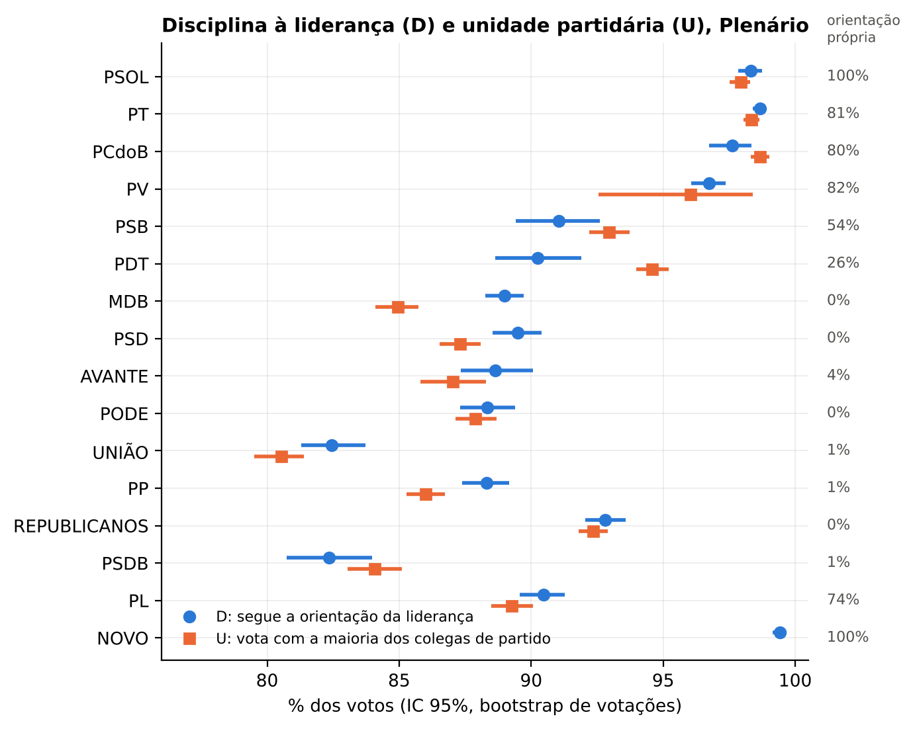
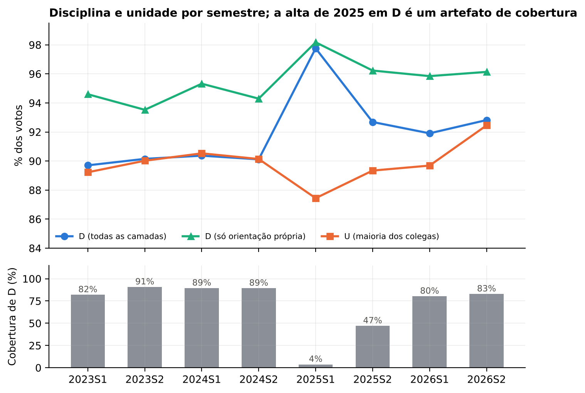
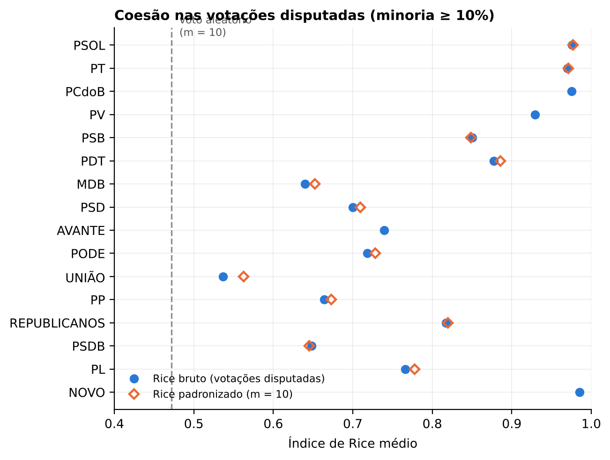
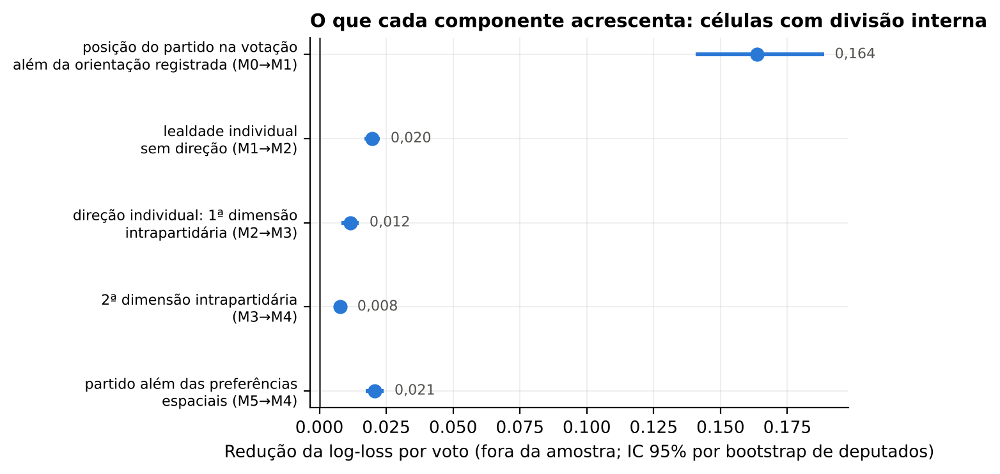
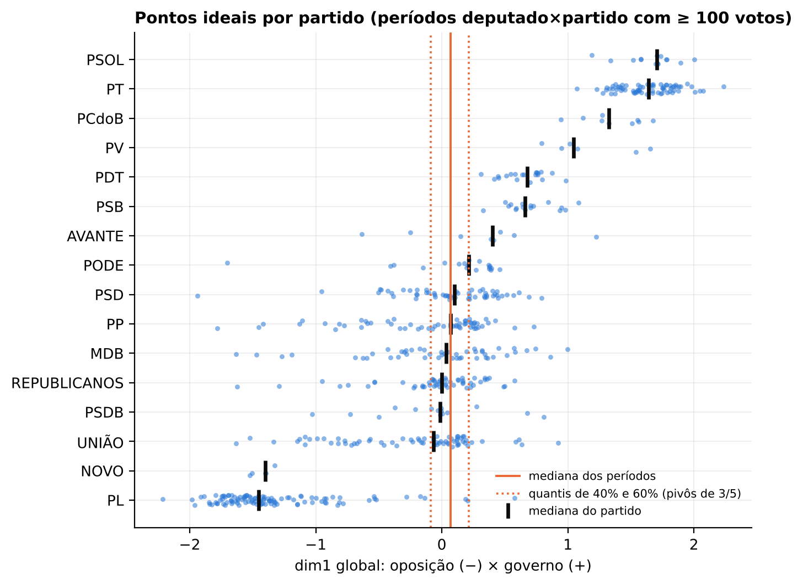
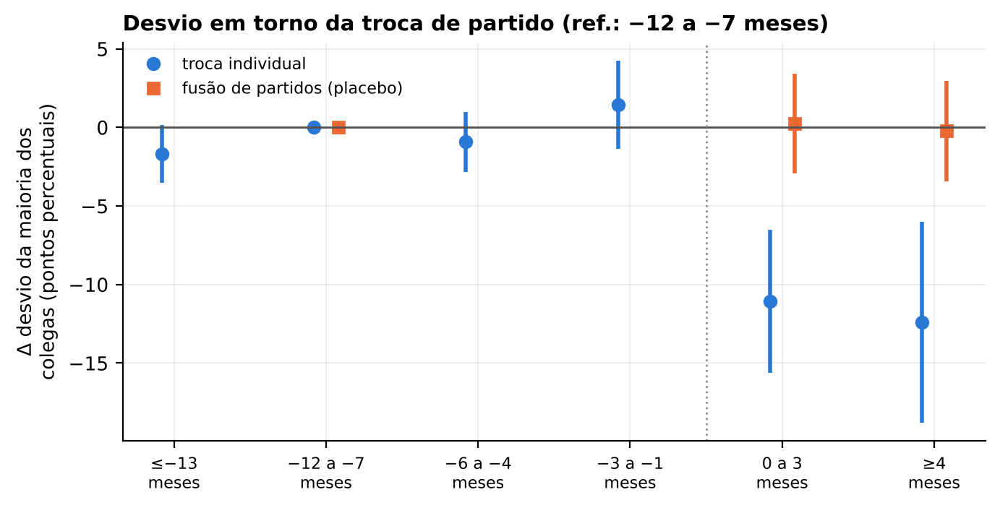
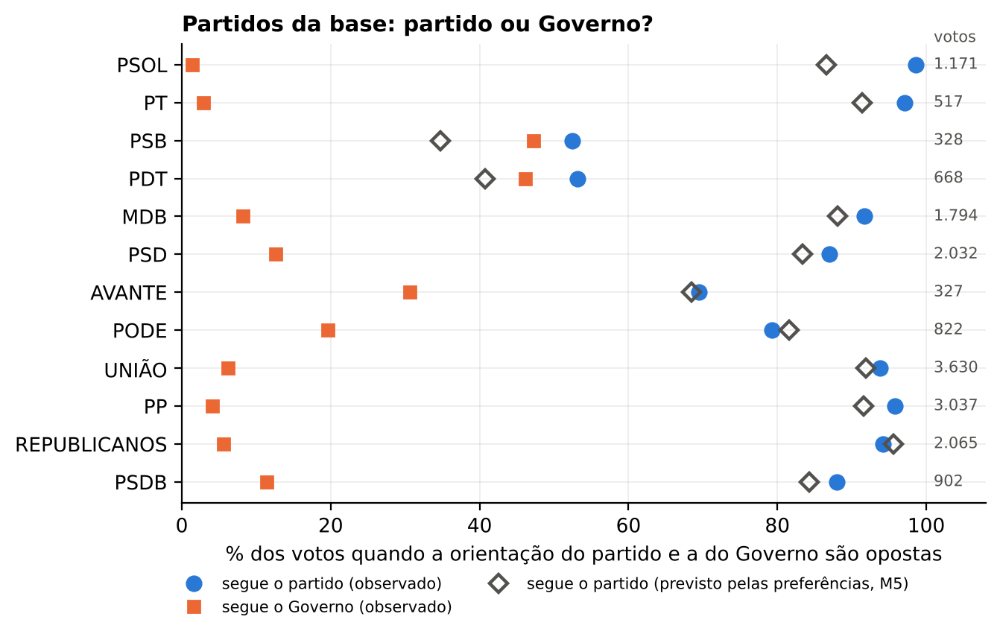

<!-- Arquivo gerado por analise.py a partir de artigo_fonte.md; não edite à mão. -->
# Disciplina à liderança, unidade partidária e dissidência estruturada na Câmara dos Deputados (57ª Legislatura, 2023–2026)

**Resumo.** Quanta disciplina partidária há na Câmara dos Deputados da 57ª Legislatura, onde ela falha e se a indisciplina é ruído ou tem estrutura? Analisamos os 454.829 votos nominais dados em 1.126 votações do Plenário entre 14/03/2023 e 14/10/2026, cruzados com a orientação das lideranças. Mostramos primeiro um problema de medida: a "orientação do partido" publicada pela Câmara é, na maior parte dos votos do centro e da centro-direita, orientação de **bloco**, e em 2025 um megabloco de Mesa que reunia o PL e a federação do PT praticamente deixou de orientar, de modo que a disciplina medida no 1º semestre de 2025 sobe por artefato de cobertura. Por isso distinguimos a disciplina à liderança (D: voto na direção da orientação aplicável) da unidade partidária (U: voto com a maioria dos demais colegas). A disciplina é alta, 90,9% (U: 89,5%), quase total em PSOL, PT, PCdoB e NOVO e mais baixa em União, PSDB e PP; a variação temporal real (em U) é pequena. Em validação cruzada de 5 dobras, um modelo de pontos ideais intrapartidário (efeito fixo partido×votação mais pontos centrados no partido) reduz a log-loss fora da amostra em relação a um modelo só com a posição do partido e a um modelo com propensão individual de desvio sem direção; o ganho é pequeno, mas o intervalo exclui zero. A dimensão de dissidência é interpretável: é governismo relativo (a carga das votações tem o sinal da orientação do Governo em 100% das 100 votações mais carregadas) e a posição intrapartidária anterior a 2026 antecipa a direção de 62% das trocas de partido na janela de 2026. A distância ideológica ao partido, medida no outro biênio, domina os correlatos do desvio; suplência, sexo, idade e tamanho da bancada estadual não se associam a ele. Depois de uma troca individual de partido o desvio cai cerca de 11,1 pontos percentuais, sem pré-tendência. Quando o partido da base e o Governo orientam em sentidos opostos, 89,4% dos votos seguem o partido, 3,9 pontos acima do que as preferências espaciais preveem.

**Palavras-chave:** disciplina partidária; orientação de bancada; pontos ideais; Câmara dos Deputados; presidencialismo de coalizão; votações nominais.

**Abstract.** How much party discipline is there in the 57th Legislature of the Brazilian Chamber of Deputies, where does it break down, and is indiscipline noise or structure? We analyze 454.829 roll-call votes cast in 1.126 floor votes (14/03/2023–14/10/2026) matched to leadership vote recommendations. We first document a measurement problem: for most centrist and centre-right deputies the recorded "party" recommendation is a **bloc** recommendation, and in 2025 a heterogeneous bloc formed for the Speaker's election (joining PL and the PT federation) almost stopped issuing recommendations, so measured discipline in early 2025 rises as an artefact of coverage. We therefore separate discipline to the leadership (D) from party unity (U: voting with the majority of one's other party colleagues). Discipline is high (90,9%; U 89,5%), nearly complete in PSOL, PT, PCdoB and NOVO and lowest in União, PSDB and PP; genuine change over time (in U) is small. In 5-fold cross-validation, an intra-party ideal-point model (party-by-vote fixed effects plus party-centred ideal points) lowers out-of-sample log-loss relative to a party-position-only model and to a model with a non-directional individual propensity to defect; the gain is small but its interval excludes zero. The dissent dimension is interpretable as relative pro-government voting (vote loadings carry the sign of the government's recommendation in 100% of the 100 highest-loading votes), and pre-2026 intra-party positions anticipate the direction of 62% of the party switches in the 2026 switching window. Ideological distance from the party, measured in the other half of the term, dominates the correlates of defection, while alternate status, sex, age and state delegation size do not. Defection drops by about 11,1 percentage points after an individual party switch, with no pre-trend. When a coalition party and the government recommend opposite votes, 89,4% of votes follow the party, 3,9 points more than spatial preferences predict.

**Keywords:** party discipline; party leadership recommendations; ideal points; Brazilian Chamber of Deputies; coalitional presidentialism; roll-call votes.

---

## 1. Introdução

A disciplina partidária na Câmara dos Deputados é um dos temas mais estudados da ciência política brasileira desde que Figueiredo e Limongi (1999) mostraram, contra a expectativa de partidos fracos e deputados individualistas (Mainwaring, 1999; Ames, 2001), que os deputados votam, em regra, com a orientação dos seus líderes. Este artigo revisita a pergunta na 57ª Legislatura (2023–2027), sob o terceiro governo Lula, com uma estratégia que combina medidas descritivas de disciplina e coesão com modelos de pontos ideais avaliados fora da amostra. As perguntas são quatro: (P1) quanta disciplina há e onde ela falha — por partido, ano, tipo de orientação, tipo de votação e tema; (P2) a indisciplina é ruído ou tem estrutura, isto é, existe uma dimensão intrapartidária de baixa dimensão e interpretável; (P3) quem são os dissidentes sistemáticos e que características se associam ao desvio; e (P4) o que o voto individual acrescenta à orientação do líder — inclusive quando a orientação do partido diverge da do Governo.

O artigo faz quatro contribuições. A primeira é de **medida**. A Câmara publica a orientação de cada bancada — partido, federação ou bloco — e a prática corrente é tratar a orientação aplicável ao deputado como "orientação do partido". Mostramos que, na 57ª Legislatura, a bancada que orienta é o próprio partido ou federação em só 33,9% dos votos do Plenário; no restante, é um bloco (36,8%), de blocos atribuídos por inferência porque a Câmara trunca seus nomes (11,2%) ou de um bloco heterogêneo formado em 2025 para a eleição da Mesa, que reunia o PL e a federação do PT (18,1%). Esse megabloco orientou em apenas 19 das 227 votações em que foi a bancada aplicável, e a orientação vazia chegou a 59,5% dos votos em 2025. A consequência é que a série temporal da disciplina "à orientação" é, em 2025, um artefato de cobertura. Propomos medir lado a lado a disciplina à liderança (D), estratificada pela fonte da orientação, e a unidade partidária (U), definida pela maioria dos demais colegas, que não depende de registros de orientação.

A segunda contribuição é um **teste explícito de "ruído versus estrutura"** para a indisciplina. Modelos de pontos ideais com efeitos fixos partido×votação já foram usados para separar preferência e pressão partidária (Snyder e Groseclose, 2000; McCarty, Poole e Rosenthal, 2001; Zucco e Lauderdale, 2011), mas a pergunta sobre se o que sobra dentro do partido tem estrutura raramente é posta como um problema de previsão fora da amostra contra linhas de base adequadas. Comparamos seis modelos aninhados, da regra "segue a orientação" a um modelo intrapartidário de duas dimensões, e isolamos o valor de uma propensão individual de desvio sem direção (lealdade) do valor da direção espacial da dissidência.

A terceira é **interpretar** a dimensão intrapartidária pelas votações que mais a carregam, por correlatos externos (alinhamento ao Governo, frentes parlamentares) e por uma validação preditiva: se a posição de um deputado dentro do partido for substantiva, ela deve antecipar quem trocará de partido na janela de 2026 e em que direção. A quarta é tratar a **troca de partido** como estudo de evento com efeitos fixos de deputado e de partido×votação, e a **divergência entre partido e Governo** com uma linha de base contrafactual dada pelas preferências estimadas fora da amostra.

Os resultados sustentam uma leitura de disciplina alta, mas não de deputados indistinguíveis: a maior parte da previsibilidade do voto está na posição coletiva do partido em cada votação, a indisciplina restante não é ruído puro, e sua estrutura é a do eixo governo × oposição recortado dentro de cada partido. Este artigo é um de sete trabalhos irmãos de um mesmo projeto sobre a 57ª Legislatura; os demais tratam de outros blocos (representações dos deputados por temas, frentes e discursos, trajetórias partidárias, entre outros) e são citados aqui apenas como trabalhos relacionados do projeto.

## 2. Duas tradições

### 2.1 Disciplina e coesão no presidencialismo de coalizão

A medida clássica de coesão de um grupo legislativo é o índice de Rice (Rice, 1925), a diferença absoluta entre as proporções de votos Sim e Não do grupo numa votação. O índice tem dois problemas conhecidos. Ele é inflado em grupos pequenos, porque a variabilidade amostral de proporções em bancadas de poucos membros produz valores altos mesmo sem coesão real; Desposato (2005) propõe padronizar o índice pelo valor esperado numa subamostra de tamanho fixo. E ele confunde coesão com consenso: em votações quase unânimes, todo partido parece coeso. Por isso a literatura comparada restringe a análise a votações disputadas ou pondera pela disputa (Carey, 2007; 2009). Carey também distingue *unidade* (votar junto) de *disciplina* (votar com o líder contra a própria preferência), e mostra que a unidade é menor onde há "principais concorrentes" — eleitores, governadores, o presidente — que disputam a lealdade do legislador.

No Brasil, Figueiredo e Limongi (1999) mostraram que a centralização dos trabalhos nos líderes e os poderes de agenda do Executivo produzem disciplina alta e previsível; a orientação do líder é o melhor preditor do voto. A leitura oposta (Mainwaring, 1999; Ames, 2001) enfatizava lista aberta, federalismo e patronagem como fontes de indisciplina. Nicolau (2000) documentou disciplina e base parlamentar no primeiro governo Fernando Henrique a partir das votações nominais. Zucco (2009) e Zucco e Lauderdale (2011) mostraram que o comportamento dos deputados brasileiros responde a influências do Executivo além da ideologia, e Power e Zucco (2009) forneceram âncoras de ideologia partidária. Kam (2009) e Cox e McCubbins (2005) lembram duas cautelas: a dissidência responde ao desalinhamento entre preferência e partido, e a coesão observada é em parte produto do controle de agenda, que evita votações que dividiriam a bancada. Carrubba, Gabel e Hug (2008) acrescentam que votações nominais não são amostra aleatória das decisões, o que vale com força para a Câmara: só 16,5% das 6.855 votações de Plenário da legislatura tiveram votos nominais.

### 2.2 Modelos espaciais: preferência ou partido?

A segunda tradição estima posições latentes dos legisladores a partir das votações (Poole e Rosenthal, 1997; Clinton, Jackman e Rivers, 2004). Krehbiel (1993) argumenta que coesão partidária não prova influência do partido: legisladores com preferências parecidas votam juntos sem pressão alguma. Snyder e Groseclose (2000) propuseram identificar a pressão partidária comparando votações em que ela atuaria com votações lopsided, e McCarty, Poole e Rosenthal (2001) modelaram linhas de corte específicas por partido, concluindo que a segunda linha melhora pouco o ajuste. Black (1948) e Krehbiel (1998) dão a razão para olhar o legislador mediano e os pivôs de maioria qualificada: são eles que decidem o resultado sob regras de maioria. Bafumi et al. (2005) e Lauderdale (2010) discutem identificação e votantes imprevisíveis em modelos de pontos ideais, ponto relevante quando o objeto é justamente o desvio.

Das duas tradições derivamos expectativas e o que as contrariaria. **E1** (Figueiredo e Limongi): disciplina alta (em torno de 90%) e estável; contrariada por variação temporal grande em U. **E2** (Desposato; Carey): o ranking de coesão entre partidos é estável a correções de tamanho e de disputa; contrariada por inversões. **E3** (Krehbiel; Clinton, Jackman e Rivers): se a dissidência for preferência individual estruturada, um modelo com direção espacial intrapartidária prevê melhor que um modelo de lealdade sem direção; contrariada por ganho nulo fora da amostra. **E4** (Zucco): a direção da dissidência é o governismo relativo; contrariada por cargas sem padrão. **E5** (Carey, principais concorrentes): na divergência entre partido e Governo, o partido prevalece além das preferências; contrariada por "excesso de lealdade" nulo.

## 3. Dados

Os dados são os Dados Abertos da Câmara dos Deputados para a 57ª Legislatura, coletados até 11/11/2026 pelos scripts do projeto (`baixar_legislatura.py`). A base de votos tem 471.314 votos válidos em 1.602 votações nominais (Plenário e comissões), dos quais 454.829 em 1.126 votações do Plenário, dadas por 644 deputados (titulares e suplentes), em média 403,9 votantes por votação. A análise principal usa só o Plenário; comissões entram como robustez. Excluímos os 1.045 registros "Artigo 17" (o presidente da sessão não vota), votos sem registro e deputados sem partido. A Tabela 1 distribui as votações por tipo — classificado por regras sobre o texto da votação — e ano.

**Tabela 1 – Votações nominais do Plenário por tipo e ano (57ª Legislatura, 14/03/2023 a 14/10/2026)**

| Tipo de votação | 2023 | 2024 | 2025 | 2026 | Total |
|---|---|---|---|---|---|
| Destaque (texto) | 53 | 41 | 83 | 16 | 193 |
| Emenda / destaque de emenda | 49 | 45 | 38 | 13 | 145 |
| Mérito (texto principal) | 55 | 51 | 100 | 24 | 230 |
| PEC (mérito) | 5 | 6 | 11 | 8 | 30 |
| Requerimento procedimental | 74 | 71 | 148 | 31 | 324 |
| Urgência | 64 | 59 | 48 | 33 | 204 |
| Total | 300 | 273 | 428 | 125 | 1126 |

*Tipo atribuído por regras sobre o texto de votacoes.descricao (ver Método).*

**Partido na data.** Usamos o partido do deputado na data de cada votação. O partido "atual" do cadastro reflete a janela partidária de março–abril de 2026, quando ocorreram 130 das 191 trocas individuais de partido da legislatura; usá-lo atribuiria a 2023 filiações de 2026. Das 210 transições registradas, 19 são fusões ou incorporações (PSC→PODE, PATRIOTA→PRD, PTB→PRD, PROS→SOLIDARIEDADE), não decisões individuais, e são tratadas à parte.

**Orientações.** Para cada voto, o projeto associa a orientação da bancada aplicável ao partido do deputado na data — o próprio partido; senão, a federação; senão, o bloco — e as orientações de Governo, Maioria, Minoria e Oposição. Como a Câmara publica nomes de blocos abreviados e truncados, partidos sem orientação própria são atribuídos ao bloco truncado por inferência (cerca de 18% de todos os votos). Classificamos cada voto em quatro camadas: orientação **própria** (partido ou federação), **bloco** explícito, **bloco inferido** e **bloco heterogêneo** — o bloco que reuniu o PL e a federação PT-PCdoB-PV entre 11/02/2025 e 19/08/2025, um bloco de Mesa e não de coordenação de voto. Orientações desse bloco não contam como orientação do partido. A orientação "Liberado" e a orientação vazia (a liderança não orientou) ficam fora da medida de disciplina.

**Exercício do mandato.** A partir do histórico de situação dos deputados reconstruímos os períodos de exercício e a condição (titular ou suplente) em cada data. O painel valida bem: em média há 513,1 deputados em exercício nas datas de votação, e em 99,3% das datas o total fica a no máximo cinco de 513. Isso permite marcar a suplência como variável no tempo, aproximar o motivo do afastamento do titular (ministro, secretário de estado ou de capital, outro) e computar pivôs entre os deputados efetivamente em exercício.

## 4. Método

### 4.1 Disciplina, unidade e coesão

Seja $v_{ij}$ o voto do deputado $i$ na votação $j$, com direção $s(v_{ij})=1$ para Sim e $0$ para Não ou Obstrução (a obstrução é um instrumento de quórum da bancada: um Não de quem recebeu ordem de obstruir não é dissidência quanto ao mérito). Seja $o_{p j}$ a orientação diretiva (Sim, Não ou Obstrução) da bancada aplicável ao partido $p$ do deputado. A **disciplina à liderança** é

$$D = \frac{\sum_{(i,j)\in\mathcal{O}} \mathbf{1}[s(v_{ij}) = s(o_{p(i)j})]}{|\mathcal{O}|},$$

em que $\mathcal{O}$ é o conjunto de votos (Sim, Não, Obstrução ou Abstenção) com orientação diretiva nas camadas própria, bloco ou bloco inferido. Abstenção conta como desvio; a versão estrita (Obstrução ≠ Não) e a versão sem abstenções são robustez. Toda taxa é reportada com sua **cobertura**, $|\mathcal{O}|$ dividido pelos votos válidos.

A **unidade partidária** compara o deputado à maioria dos demais colegas presentes:

$$U = \frac{1}{|\mathcal{U}|}\sum_{(i,j)\in\mathcal{U}} \mathbf{1}\big[s(v_{ij}) = m_{-i,j}\big],\qquad m_{-i,j}=\mathbf{1}\Big[\textstyle\sum_{k\in p(i),k\neq i} s(v_{kj}) > \tfrac{1}{2}n_{-i,j}\Big],$$

definida quando há pelo menos cinco colegas votando e não há empate. U não depende do registro de orientação e cobre 94,6% dos votos (D cobre 66,7%).

A **coesão** de um partido numa votação é o índice de Rice, $R_{pj}=|S_{pj}-N_{pj}|/(S_{pj}+N_{pj})$, calculado em células com pelo menos três votantes. Para corrigir a inflação em bancadas pequenas, usamos o valor esperado do índice numa subamostra sem reposição de $m$ membros (Desposato, 2005), calculado exatamente pela distribuição hipergeométrica:

$$\tilde R_{pj}(m)=\sum_{k=0}^{m}\frac{\binom{S}{k}\binom{N}{m-k}}{\binom{S+N}{m}}\,\frac{|2k-m|}{m},$$

com $m=10$ (principal) e $m=5$; partidos com mediana de votantes abaixo de $m$ não recebem o índice padronizado. A linha de base "sem partido" é o Rice esperado de $m$ votantes independentes que votam Sim com a probabilidade do Plenário naquela votação. Restringimos a média a votações **disputadas** (minoria do Plenário ≥ 10%; 894 votações) e, como robustez, a ≥ 20% e ao Rice ponderado pela disputa, $w_j = 1-|2q_j-1|$ (Carey, 2007).

Comparações por tipo de votação, tipo de proposição e tema (temas oficiais da Câmara, multirrótulo com peso $1/k$; cobertura de 82% das proposições votadas) são feitas em médias brutas e em médias ajustadas por efeitos fixos de partido×ano, porque a composição partidária das votações difere entre categorias.

### 4.2 Pontos ideais: global e intrapartidário

Usamos o estimador de pontos ideais do projeto (regressão logística bilinear penalizada, da família IDEAL/NOMINATE; Clinton, Jackman e Rivers, 2004), sem modificá-lo. Para o voto Sim ($y_{ij}=1$) ou Não/Obstrução ($y_{ij}=0$) do deputado $i$, no período $r(i)$ de filiação a um partido $p$, na votação $j$:

$$\Pr(y_{ij}=1)=\sigma\big(a_j + g_{p j} + \mathbf{b}_j^\top \mathbf{x}_{r}\big),\qquad \mathbf{x}_r=\mathbf{u}_{i}+\boldsymbol{\delta}_r,$$

com penalidades gaussianas (priors) em todos os parâmetros, estimação por máxima verossimilhança penalizada (L-BFGS) e votações com minoria abaixo de 2,5% excluídas. O modelo **global** omite $g$; o **intrapartidário** inclui o efeito fixo partido×votação $g_{pj}$, que absorve a posição do partido em cada votação, e centra os pontos $\mathbf{x}_r$ dentro de cada partido, de modo que sobra só a variação individual. A amostra do modelo tem 417.832 votos, 1.039 votações, 828 períodos deputado×partido e 20.759 células partido×votação (mediana de 11,0 votantes por célula; 27% com menos de cinco).

### 4.3 Ruído ou estrutura: seis modelos fora da amostra

Comparamos, nas mesmas dobras, seis modelos aninhados:

- **M0** — a regra "segue a orientação": a orientação diretiva aplicável; na ausência, a maioria de treino do partido na votação; na ausência, a maioria de treino da votação. A probabilidade é calibrada pela taxa de acerto da regra no treino.
- **M1** — só $a_j+g_{pj}$: a posição coletiva do partido em cada votação (o modelo intrapartidário com variância individual levada a zero por penalidade alta, para manter a mesma penalização de $g$).
- **M2** — M1 mais uma **lealdade individual sem direção**: $\sigma(z^{M1}_{ij}+\rho_i\,d_{pj})$, com $d_{pj}=+1$ se a maioria de treino da célula votou Não e $-1$ se votou Sim; $\rho_i>0$ é a propensão de votar contra a maioria do próprio partido, em qualquer direção.
- **M3** e **M4** — o modelo intrapartidário com uma e duas dimensões.
- **M5** — o modelo global de duas dimensões, sem partido.

M1→M2 mede o valor da lealdade; M2→M3, o valor da **direção** da dissidência; M3→M4, o de uma segunda dimensão; M5→M4, o do partido além das preferências espaciais. A validação cruzada é em cinco dobras sobre células deputado×votação, estratificada por votação (cada votação contribui com cerca de 20% dos seus votos para cada dobra, o que mantém $a_j$, $\mathbf{b}_j$ e $g_{pj}$ estimáveis). A métrica principal é a log-loss; reportamos também Brier, acurácia e a precisão média (AUC-PR) ao ranquear os votos contra a maioria de treino da célula. A acurácia é pouco informativa quando a taxa-base de seguir o partido passa de 88%. Avaliamos em todas as células e nas **células com divisão interna**: partido×votação com pelo menos cinco colegas no treino e pelo menos um voto contra a maioria do partido no treino (definidas só com informação de treino, para não selecionar pela variável dependente). Os intervalos das diferenças de log-loss vêm de bootstrap de deputados (1.000 réplicas) sobre as perdas de teste.

### 4.4 Correlatos do desvio, troca de partido e divergência com o Governo

**Quem desvia.** Ao nível do voto, estimamos um modelo de probabilidade linear

$$\text{desvio}_{ij} = \boldsymbol{\beta}^\top \mathbf{z}_{i}(t) + \gamma_{p(i,t)\,j} + \varepsilon_{ij},$$

em que $\gamma_{pj}$ (efeito fixo partido×votação) absorve a orientação, o conteúdo da votação, o momento e o grau de racha do partido, de modo que $\boldsymbol\beta$ compara deputados do mesmo partido na mesma votação. As covariáveis são suplência em exercício (por motivo do afastamento do titular), sexo, idade, log das cadeiras legais da UF, um indicador de troca individual de partido na legislatura e a distância à mediana do partido na dimensão governo × oposição **estimada com as votações do outro biênio** (2023–24 para votos de 2025–26 e vice-versa), para não usar o desfecho na medida de preferência. Os erros-padrão são agrupados em duas vias, por deputado e por votação (V = Vdep + Vvot − Vdep∩vot). O efeito da UF é testado conjuntamente (Wald, 26 g.l.). Decompomos ainda a variância das taxas brutas de desvio entre deputados em sinal e ruído binomial e na parte entre partidos.

**Troca de partido.** Para os deputados com troca individual, estimamos um estudo de evento

$$\text{desvio}_{ij}=\alpha_i+\gamma_{p(i,t)j}+\sum_{k\neq k_0}\theta_k\,\mathbf{1}[t_j-T_i\in k]+\varepsilon_{ij},$$

com janelas em meses relativos à troca (≤ −13, −12 a −7 [referência], −6 a −4, −3 a −1, 0 a 3, ≥ 4). O efeito fixo de deputado retira a propensão individual, e o de partido×votação retira a tendência geral e o fato de o grupo de referência mudar com a troca. As fusões entram como grupo placebo (troca sem escolha). O desfecho principal é o desvio de U, definido dos dois lados da troca.

**Partido × Governo.** Selecionamos os votos em que a orientação diretiva do partido e a do Governo são opostas, separando os partidos da base dos de oposição permanente (PL e NOVO). Como os líderes escolhem onde divergir, a taxa de "segue o partido" mede ao mesmo tempo autoridade do líder e acompanhamento da bancada. Comparamos então o observado com a probabilidade de seguir o partido prevista, fora da amostra, pelo modelo global sem partido (M5, previsões de validação cruzada): o **excesso de lealdade** é a diferença. Dentro de cada partido×votação, um modelo de probabilidade linear indica quem segue o Governo contra o partido.

### 4.5 Incerteza e reprodutibilidade

Taxas e excessos têm intervalos por bootstrap de votações (1.000 réplicas). Dispersões, pivôs e dissidentes usam bootstrap de votações com reajuste do modelo global (100 réplicas), com cada réplica alinhada ao ajuste completo por rotação de Procrustes. Todos os números, tabelas e figuras são gerados por `analise.py` a partir de `dados/leg57`; o próprio manuscrito é montado a partir de um modelo em que cada número é uma referência a `resultados.json`.

## 5. Resultados

### 5.1 Quanta disciplina

A disciplina à liderança no Plenário é de 90,9% (IC 95%: 90,4–91,3), e a unidade partidária, de 89,5%. A Tabela 2 e a Figura 1 mostram a distribuição por partido. PT (98,7%), PSOL (98,3%), PCdoB (97,6%) e NOVO (99,4%) votam quase sempre com a liderança; União (82,5%) e PSDB (82,3%) estão no outro extremo; PP, PSD, MDB, PODE e AVANTE ficam entre 88% e 90%, REPUBLICANOS em 92,8% e o PL em 90,5%. Esses números reproduzem a ordem de grandeza das taxas prévias do projeto (cerca de 98% em PT, PSOL e NOVO e de 83% a 92% no centrão).

**Tabela 2 – Disciplina à liderança (D), unidade (U) e coesão (Rice) por partido, Plenário**

| Partido | D (IC 95%) | Cob. D | D própria | U (IC 95%) | U 2023 | U 2024 | U 2025 | U 2026 | Rice disp. | Rice m=10 | % racha |
|---|---|---|---|---|---|---|---|---|---|---|---|
| PSOL | 98,3 [97,8; 98,7] | 86 | 98,3 | 97,9 [97,5; 98,3] | 97,3 | 97,1 | 98,5 | 99,3 | 0,98 | 0,98 | 1 |
| PT | 98,7 [98,4; 98,9] | 79 | 98,7 | 98,3 [98,0; 98,6] | 97,9 | 98,6 | 98,2 | 99,2 | 0,97 | 0,97 | 1 |
| PCdoB | 97,6 [96,7; 98,3] | 77 | 97,6 | 98,7 [98,3; 99,0] | 98,7 | 98,9 | 98,9 | 97,7 | 0,98 | – | 1 |
| PV | 96,7 [96,1; 97,4] | 80 | 96,7 | 96,0 [92,6; 98,4] | 95,8 | 95,2 | – | 97,1 | 0,93 | – | 5 |
| PSB | 91,0 [89,4; 92,6] | 56 | 95,1 | 92,9 [92,2; 93,7] | 93,4 | 95,5 | 90,7 | 94,0 | 0,85 | 0,85 | 9 |
| PDT | 90,2 [88,6; 91,9] | 61 | 96,4 | 94,6 [94,0; 95,2] | 95,2 | 94,2 | 93,8 | 97,0 | 0,88 | 0,89 | 8 |
| MDB | 89,0 [88,3; 89,7] | 60 | 94,1 | 84,9 [84,1; 85,7] | 87,4 | 87,2 | 82,0 | 83,8 | 0,64 | 0,65 | 24 |
| PSD | 89,5 [88,5; 90,4] | 60 | 90,2 | 87,3 [86,5; 88,1] | 91,0 | 87,8 | 84,3 | 88,2 | 0,70 | 0,71 | 18 |
| AVANTE | 88,6 [87,3; 90,1] | 55 | 92,7 | 87,0 [85,8; 88,3] | 84,6 | 91,0 | 86,6 | 85,9 | 0,74 | – | 19 |
| PODE | 88,3 [87,3; 89,4] | 60 | 92,3 | 87,9 [87,1; 88,7] | 87,0 | 88,5 | 88,1 | 87,8 | 0,72 | 0,73 | 14 |
| UNIÃO | 82,4 [81,3; 83,7] | 64 | 90,1 | 80,5 [79,5; 81,4] | 82,5 | 80,2 | 78,9 | 82,2 | 0,54 | 0,56 | 48 |
| PP | 88,3 [87,4; 89,2] | 64 | 94,9 | 86,0 [85,3; 86,7] | 88,2 | 87,1 | 84,1 | 84,5 | 0,66 | 0,67 | 22 |
| REPUBLICANOS | 92,8 [92,1; 93,6] | 59 | 100,0 | 92,4 [91,8; 92,9] | 91,5 | 93,8 | 92,5 | 90,5 | 0,82 | 0,82 | 5 |
| PSDB | 82,3 [80,8; 84,0] | 64 | 89,4 | 84,1 [83,0; 85,1] | 83,3 | 86,7 | 81,5 | 88,4 | 0,65 | 0,65 | 26 |
| PL | 90,5 [89,6; 91,3] | 71 | 90,3 | 89,3 [88,5; 90,1] | 87,1 | 89,9 | 90,3 | 89,9 | 0,77 | 0,78 | 14 |
| NOVO | 99,4 [99,1; 99,7] | 96 | 99,4 | – | – | – | – | – | 0,98 | – | 1 |

*D: voto na direção da orientação diretiva da bancada (Não = Obstrução; Abstenção = desvio), camadas própria, bloco e bloco inferido, sem o bloco heterogêneo de 2025. Cob. D: % dos votos do partido com orientação diretiva aplicável. U: voto na direção da maioria dos demais colegas (≥ 5). Rice em votações com minoria ≥ 10%; m = 10: padronização de Desposato; '% racha': votações disputadas com Rice < 0,5. IC por bootstrap de votações (1.000 réplicas).*

*Figura 1 – Disciplina à liderança (D) e unidade (U) por partido, com IC 95% por bootstrap de votações. À direita, a parcela dos votos do partido sob orientação própria (partido ou federação); para os partidos do centro, a orientação é quase toda de bloco. NOVO não tem U porque a bancada nunca reúne cinco colegas votando.*

A fonte da orientação importa. A disciplina é de 94,9% quando a orientação é do próprio partido ou federação, 87,2% sob orientação de bloco e 88,0% sob bloco inferido. A orientação própria é a regra só em PSOL, PT, PCdoB, PV, PL e NOVO (e em parte de PSB e PDT); em União, PP, PSD, MDB, REPUBLICANOS, PODE e PSDB, menos de 2% dos votos estão sob orientação do próprio partido. Para esses partidos, o que se chama de disciplina partidária é, na prática, **disciplina ao líder do bloco**. Quando se restringe D à orientação própria, os poucos votos desses partidos sob orientação do próprio partido mostram taxas maiores (por exemplo, PP 95,0%, MDB 94,1%), coerentes com a ideia de que o partido orienta quando está unido.

A Figura 2 mostra a série semestral. Em D, a disciplina sobe para 92,9% em 2025 contra 90,1% em 2023. Mas a cobertura de D cai a 32% em 2025 (contra 89% em 2023), porque a liderança aplicável — sobretudo o megabloco — deixou de orientar. Em U, que não depende do registro, 2025 é o ano de **menor** unidade (88,7%, contra 89,8% em 2023 e 90,0% em 2026). A alta de 2025 é um artefato de cobertura; a variação real no tempo é de cerca de um ponto percentual, compatível com E1.

*Figura 2 – Disciplina (D, todas as camadas e só orientação própria) e unidade (U) por semestre; abaixo, a cobertura de D (parcela dos votos com orientação diretiva aplicável).*

### 5.2 Onde a disciplina falha

**Tipo de orientação.** A disciplina é maior quando a orientação é Sim (91,7%) do que quando é Não (89,5%). Sob orientação de Obstrução, a adesão literal é de 75,0%: dos que não obstruíram, a maioria votou Não (13,6% dos votos) — mesma direção, sem aderir à tática — e só 10,4% votaram Sim, contra a bancada. Na medida direcional, a disciplina sob obstrução é de 88,6%.

**Liberação.** Quando o partido libera a bancada, a unidade cai de 91,6% (votações orientadas) para 79,5%, e isso ocorre em 16 dos 16 partidos analisados. A liberação sinaliza racha, mas não o produz sozinha: mesmo liberados, cerca de quatro em cada cinco deputados votam com a maioria dos colegas.

**Tipo de votação e de proposição.** A Tabela 3 mostra que a disciplina é maior em PECs (94,3% no mérito) e no mérito de projetos (92,5%) do que em destaques (89,5%), emendas (88,9%) e requerimentos procedimentais (90,4%). O ajuste por partido×ano quase não altera os números. Entre tipos de proposição, os projetos de decreto legislativo (PDL) são os mais disciplinados (93,9%). Na PEC, porém, a ausência é uma forma de desvio, porque a aprovação exige 308 votos Sim. Contando como desvio os membros em exercício ausentes nas 28 votações de mérito de PEC com orientação Sim do partido, a disciplina cai de 94,9% para 83,8% (11,7% dos membros em exercício estavam ausentes).

**Tabela 3 – Disciplina (D) e unidade (U) por tipo de votação e de proposição, Plenário**

| Recorte | Categoria | Votações | D | U | D ajust. | U ajust. |
|---|---|---|---|---|---|---|
| Tipo de votação | Destaque (texto) | 193 | 89,5 | 88,0 | 89,4 | 88,1 |
| Tipo de votação | Emenda / destaque de emenda | 144 | 88,9 | 89,0 | 89,0 | 88,9 |
| Tipo de votação | Mérito (texto principal) | 227 | 92,5 | 90,4 | 92,4 | 90,4 |
| Tipo de votação | PEC (mérito) | 29 | 94,3 | 94,1 | 94,3 | 94,2 |
| Tipo de votação | Requerimento procedimental | 318 | 90,4 | 89,0 | 90,3 | 89,1 |
| Tipo de votação | Urgência | 204 | 91,9 | 90,6 | 92,0 | 90,4 |
| Tipo de proposição | MPV | 75 | 91,0 | 90,5 | 91,1 | 90,5 |
| Tipo de proposição | PDL | 42 | 93,9 | 93,4 | 93,6 | 93,9 |
| Tipo de proposição | PEC | 103 | 90,2 | 89,5 | 90,5 | 89,5 |
| Tipo de proposição | PL | 703 | 90,9 | 89,2 | 90,8 | 89,2 |
| Tipo de proposição | PLP | 170 | 90,8 | 90,1 | 90,9 | 90,0 |

*'Ajust.': média prevista de cada categoria com efeitos fixos de partido×ano (composição partidária da amostra toda).*

**Tema.** A Tabela 4 mostra que a unidade varia de 84,4% (homenagens e datas comemorativas, votações de baixo custo para o desvio) e 86,1% (política, partidos e eleições, em que interesses eleitorais individuais estão em jogo) a 93,9% (agricultura) e 94,6% (estrutura fundiária). Uma leitura possível é que nos temas de maior unidade a linha de divisão coincide com a fronteira entre partidos (governo × oposição na questão fundiária e agrícola), enquanto nos de menor unidade há interesses que cortam as bancadas; a análise não testa esse mecanismo.

**Tabela 4 – Disciplina (D) e unidade (U) por tema da proposição votada (ordem crescente de U)**

| Tema | Votações | D | U |
|---|---|---|---|
| Homenagens e Datas Comemorativas | 32 | 85,7 | 84,4 |
| Política, Partidos e Eleições | 44 | 88,9 | 86,1 |
| Comunicações | 32 | 85,4 | 86,3 |
| Direito e Justiça | 51 | 90,9 | 86,3 |
| Direito e Defesa do Consumidor | 18 | 86,9 | 87,2 |
| Administração Pública | 330 | 89,9 | 87,3 |
| Processo Legislativo e Atuação Parlamentar | 40 | 92,0 | 87,8 |
| Cidades e Desenvolvimento Urbano | 25 | 88,6 | 88,1 |
| Finanças Públicas e Orçamento | 427 | 89,4 | 88,7 |
| Arte, Cultura e Religião | 38 | 92,5 | 88,8 |
| Outros temas | 11 | 91,8 | 89,1 |
| Esporte e Lazer | 17 | 88,8 | 89,3 |
| Economia | 163 | 90,1 | 89,6 |
| Viação, Transporte e Mobilidade | 59 | 90,8 | 90,0 |
| Trabalho e Emprego | 87 | 91,7 | 90,2 |
| Energia, Recursos Hídricos e Minerais | 60 | 91,4 | 90,3 |
| Relações Internacionais e Comércio Exterior | 57 | 90,8 | 90,3 |
| Direitos Humanos e Minorias | 178 | 91,2 | 90,4 |
| Ciência, Tecnologia e Inovação | 34 | 90,0 | 90,4 |
| Meio Ambiente e Desenvolvimento Sustentável | 119 | 91,8 | 90,7 |
| Defesa e Segurança | 86 | 93,8 | 90,7 |
| Direito Constitucional | 23 | 92,4 | 91,4 |
| Direito Penal e Processual Penal | 95 | 92,7 | 91,8 |
| Indústria, Comércio e Serviços | 72 | 91,5 | 91,9 |
| Educação | 64 | 93,6 | 92,0 |
| Direito Civil e Processual Civil | 32 | 92,2 | 92,2 |
| Previdência e Assistência Social | 41 | 93,4 | 93,0 |
| Saúde | 76 | 94,8 | 93,4 |
| Agricultura, Pecuária, Pesca e Extrativismo | 43 | 94,8 | 93,9 |
| Estrutura Fundiária | 45 | 94,8 | 94,6 |

*Temas oficiais da Câmara (multi-rótulo, peso 1/k); temas com < 15 votações em 'Outros temas'.*

### 5.3 Coesão corrigida

Nas 894 votações disputadas, o Rice médio é de 0,78, contra 0,47 esperados de dez votantes independentes (Figura 3). A correção de Desposato muda pouco os valores e nada o ordenamento: a correlação de postos entre os rankings com m = 10 e m = 5 é 1,00; entre os limiares de disputa de 10% e 20%, 1,00; entre o Rice em disputadas e o ponderado por disputa, 1,00. A expectativa E2 se sustenta. O União é o caso extremo: Rice de 0,54 nas disputadas, com a bancada rachada (menos de 75% num lado) em 48% delas; PSDB (26%), MDB (24%) e PP (22%) vêm em seguida, enquanto PT e PSOL racham em cerca de 1%.

*Figura 3 – Rice médio nas votações disputadas, bruto e padronizado (m = 10; partidos com mediana de votantes menor que 10 sem valor), e a linha de base de voto aleatório.*

### 5.4 Ruído ou estrutura

A Tabela 5 e a Figura 4 resumem a validação cruzada. Em todas as células, a regra "segue a orientação" (M0) acerta 88,2% dos votos; a posição coletiva do partido em cada votação (M1) acerta 91,4%; o modelo intrapartidário de duas dimensões (M4), 92,8% — valor próximo dos 92,9% obtidos antes no projeto com Plenário e comissões. Em log-loss, nas células com divisão interna, onde a taxa de desvio da maioria é de 15,2%:

- **M0→M1** reduz a log-loss em 0,164 (IC 0,141–0,189). A posição do partido em cada votação contém muito mais do que a orientação registrada, inclusive onde não há orientação.
- **M1→M2** (lealdade individual sem direção) reduz em 0,020 (IC 0,017–0,023). Alguns deputados desviam sistematicamente mais do que outros.
- **M2→M3** (direção da dissidência) reduz em 0,012 (IC 0,008–0,015). Saber *para que lado* o deputado costuma desviar acrescenta informação além de saber *quanto* ele desvia.
- **M3→M4** (segunda dimensão) acrescenta 0,008 (IC 0,006–0,010).
- **M5→M4** — o modelo global sem partido prevê pior que o intrapartidário em 0,021 (IC 0,017–0,024). Isso é compatível com a existência de um componente partidário além das preferências espaciais, mas não o prova, porque $g_{pj}$ também absorve preferências partidárias específicas de cada votação.

A indisciplina, portanto, não é ruído puro (E3 se sustenta), mas a estrutura é modesta em comparação com o que a posição do partido explica. Os ganhos não dependem de bancadas pequenas: nas células com 50 ou mais votantes, em que $g_{pj}$ não está saturado, a log-loss cai de 0,2509 (M1) para 0,2368 (M2), 0,2171 (M3) e 0,2129 (M4). A exceção são as células com menos de cinco votantes, em que M3 não melhora M2 (0,4759 contra 0,4752). São insensíveis à penalização dos pontos individuais: com $\lambda_d$ de 1 ou 16, em vez de 4, a log-loss de M3 na dobra 0 vai a 0,2493 e 0,2491, contra 0,2491. Com penalização forte do efeito fixo partido×votação ($\lambda_g=1$), M1 piora muito (0,3945, contra 0,2811) e M3 menos (0,2559): os pontos individuais compensam parte da informação partidária retirada, de modo que a vantagem de M3 sobre M1 não depende de efeitos fixos irrestritos.

**Tabela 5 – Desempenho fora da amostra (validação cruzada em 5 dobras de células deputado×votação)**

| Amostra | Modelo | Log-loss | Brier | Acurácia | AUC-PR (desvio) |
|---|---|---|---|---|---|
| todas as células | M0 orientação do líder | 0,3627 | 0,1040 | 88,22 | 0,132 |
| todas as células | M1 só partido×votação | 0,2381 | 0,0666 | 91,37 | 0,631 |
| todas as células | M2 + lealdade individual | 0,2218 | 0,0628 | 91,72 | 0,653 |
| todas as células | M3 intra 1D | 0,2083 | 0,0573 | 92,54 | 0,699 |
| todas as células | M4 intra 2D | 0,1999 | 0,0550 | 92,79 | 0,718 |
| todas as células | M5 global 2D (sem partido) | 0,2094 | 0,0606 | 91,87 | 0,681 |
| células com divisão interna | M0 orientação do líder | 0,4475 | 0,1359 | 84,08 | 0,167 |
| células com divisão interna | M1 só partido×votação | 0,2838 | 0,0831 | 88,94 | 0,677 |
| células com divisão interna | M2 + lealdade individual | 0,2641 | 0,0780 | 89,46 | 0,695 |
| células com divisão interna | M3 intra 1D | 0,2525 | 0,0730 | 90,31 | 0,723 |
| células com divisão interna | M4 intra 2D | 0,2447 | 0,0707 | 90,56 | 0,738 |
| células com divisão interna | M5 global 2D (sem partido) | 0,2655 | 0,0792 | 89,21 | 0,695 |

*Células com divisão interna: partido×votação com ≥ 5 colegas no treino e ao menos um voto contra a maioria do partido no treino. AUC-PR: precisão média ao ranquear os votos contra a maioria de treino da célula.*

*Figura 4 – Redução da log-loss fora da amostra (por voto) ao acrescentar cada componente, nas células partido×votação com divisão interna. IC 95% por bootstrap de deputados.*

### 5.5 O que é a dimensão intrapartidária

A dimensão intrapartidária de um modelo de 1D é o **governismo relativo**. A correlação entre a carga das votações e a orientação do Governo (Sim = +1, Não = −1) é 0,90, e entre as 100 votações de maior carga o sinal coincide com o da orientação do Governo em 100%. A posição intrapartidária dos deputados correlaciona 0,94 com a sua posição relativa à mediana do partido na dimensão global e 0,92 com a taxa de voto com o Governo descontada a média do partido. As votações que mais carregam a dimensão (Tabela 11) não são de um tema só. No polo positivo estão votações em que o Governo orientou Sim: a medida provisória sobre a Agência Nacional de Proteção de Dados, a autorização para o Banco do Nordeste criar subsidiárias, a depreciação acelerada e a manutenção do texto em destaques de projetos do Executivo. No polo negativo estão requerimentos procedimentais rejeitados com orientação Não do Governo, uma emenda ao regime de transição da desoneração da folha e o projeto sobre "invasores de propriedades". A dissidência intrapartidária é o eixo governo × oposição recortado dentro de cada partido, o que confirma E4 (Zucco, 2009). Requerimentos procedimentais são 38% das 100 votações de maior carga, contra 31% do total.

**Tabela 11 – Votações com maior carga na dimensão intrapartidária (modelo intra 1D)**

| Sinal | Data | Proposição | Tipo | Ementa | Gov. | Carga |
|---|---|---|---|---|---|---|
| + (governistas relativos votam Sim) | 2026-02-09 | MPV 1317/2025 | Mérito (texto principal) | Altera a Lei nº 13.709, de 14 de agosto de 2018, para tratar da Agência Nacional de Proteção de Dados, a Lei nº 10.87... | Sim | 6,57 |
| + (governistas relativos votam Sim) | 2025-11-05 | PL 2809/2024 | Destaque (texto) | Altera a Lei nº 7.797, de 10 de julho de 1989, a Lei nº 9.795, de 27 de abril de 1999, e a Lei nº 12.187, de 29 de de... | Sim | 6,53 |
| + (governistas relativos votam Sim) | 2025-04-29 | PL 3469/2024 | Destaque (texto) | Altera a Lei nº 7.565, de 19 de dezembro de 1986 – Código Brasileiro de Aeronáutica, e a Lei nº 7.957, de 20 de dezem... | Sim | 6,49 |
| + (governistas relativos votam Sim) | 2025-05-26 | PL 1708/2025 | Mérito (texto principal) | Autoriza o Banco do Nordeste do Brasil S.A. a constituir subsidiárias integrais ou controladas. | Sim | 5,88 |
| + (governistas relativos votam Sim) | 2024-12-17 | PL 3802/2024 | Urgência | Altera a Lei nº 14.467, de 16 de novembro de 2022, que dispõe sobre o tratamento tributário aplicável às perdas incor... | Sim | 5,84 |
| + (governistas relativos votam Sim) | 2025-08-19 | PL 3181/2025 | Destaque (texto) | Dispõe sobre a criação de funções comissionadas no Quadro de Pessoal do Superior Tribunal de Justiça. | Sim | 5,65 |
| + (governistas relativos votam Sim) | 2024-03-19 | PL 2/2024 | Destaque (texto) | Autoriza a concessão de quotas diferenciadas de depreciação acelerada para máquinas, equipamentos, aparelhos e instru... | Sim | 5,51 |
| + (governistas relativos votam Sim) | 2025-06-25 | PL 3118/2024 | Destaque (texto) | Altera a Lei nº 12.858, de 9 de setembro de 2013, para incluir as políticas de assistência aos estudantes da educação... | Sim | 5,47 |
| − (governistas relativos votam Não) | 2025-05-26 | PL 1708/2025 | Requerimento procedimental | Autoriza o Banco do Nordeste do Brasil S.A. a constituir subsidiárias integrais ou controladas. | Não | -5,90 |
| − (governistas relativos votam Não) | 2025-04-29 | PL 3469/2024 | Requerimento procedimental | Altera a Lei nº 7.565, de 19 de dezembro de 1986 – Código Brasileiro de Aeronáutica, e a Lei nº 7.957, de 20 de dezem... | Não | -5,72 |
| − (governistas relativos votam Não) | 2025-04-28 | PL 363/2025 | Requerimento procedimental | Altera a Lei nº 14.399, de 8 de julho de 2022, que institui a Política Nacional Aldir Blanc de Fomento à Cultura. | Não | -5,67 |
| − (governistas relativos votam Não) | 2025-07-09 | PL 769/2024 | Requerimento procedimental | Dispõe sobre a criação de funções comissionadas no Quadro de Pessoal do Supremo Tribunal Federal. | Não | -5,62 |
| − (governistas relativos votam Não) | 2026-04-22 | PL 3025/2023 | Requerimento procedimental | Dispõe sobre normas de controle de origem, compra, venda e transporte de ouro no território nacional e altera a Lei n... | Não | -5,36 |
| − (governistas relativos votam Não) | 2024-05-21 | PL 709/2023 | Mérito (texto principal) | Dispõe sobre impedimentos aplicados aos ocupantes e invasores de propriedades em todo território nacional. NOVA EMENT... | Não | -5,32 |
| − (governistas relativos votam Não) | 2024-09-11 | PL 1847/2024 | Emenda / destaque de emenda | Estabelece regime de transição para a contribuição substitutiva prevista nos arts. 7º e 8º da Lei nº 12.546, de 14 de... | Não | -5,27 |
| − (governistas relativos votam Não) | 2026-04-22 | PL 3025/2023 | Requerimento procedimental | Dispõe sobre normas de controle de origem, compra, venda e transporte de ouro no território nacional e altera a Lei n... | Não | -5,18 |

*Carga positiva: os deputados mais governistas que o próprio partido tendem a votar Sim.*

A segunda dimensão do modelo 2D não tem leitura clara: a correlação das suas cargas com a orientação do Governo é 0,10 (em módulo), e a associação com a filiação a frentes parlamentares é fraca (por exemplo, 0,11 com a frente agropecuária e -0,13 com a ambientalista). Na primeira dimensão, dentro do partido, os membros das frentes evangélica (-0,23), agropecuária (-0,18) e de segurança pública (-0,13) são menos governistas, e os da ambientalista, mais (0,19).

**Validação preditiva.** Ajustamos o modelo intrapartidário só com as votações anteriores a 2026 e perguntamos se a posição de cada deputado antecipa a janela de março–maio de 2026. A magnitude da posição (distância ao centro do partido) prevê *quem* troca com AUC de 0,59 (IC 0,54–0,65; 129 trocas entre 525 deputados), um poder discriminante modesto. O sinal da posição prevê a **direção** da troca — para um partido mais governista ou mais oposicionista que o de origem, segundo as medianas pré-2026 — em 61,8% dos 110 casos (teste binomial, p = 0,017), percentual semelhante ao da posição relativa no modelo global (64,5%). A dimensão intrapartidária carrega informação sobre decisões futuras de filiação, mas não muito além do que a posição global relativa já contém.

### 5.6 Quem desvia

A Tabela 10 traz os correlatos do desvio dentro do mesmo partido e da mesma votação. A distância ideológica à mediana do partido, medida no outro biênio, domina: cada unidade de distância na dimensão governo × oposição está associada a 25,7 pontos percentuais a mais de desvio da orientação (IC 22,3–29,0). Os deputados que trocaram de partido individualmente desviam 1,8 ponto a mais da maioria dos colegas (IC 0,4–3,2). Suplência — inclusive a de titulares nomeados ministros —, sexo, idade e o tamanho da bancada estadual não têm associação distinguível de zero ao nível de 5% (o intervalo dos suplentes de secretários toca o zero). As UFs, em conjunto, importam (χ² = 73,5, 26 g.l.), o que é compatível com principais estaduais concorrentes (Carey, 2009), mas os dados não permitem identificar o mecanismo. A expectativa krehbieliana de que a preferência domina se confirma, mas não esgota o desvio: a disciplina não é só preferência.

**Tabela 10 – Correlatos do desvio individual: MPL com efeitos fixos partido×votação**

| Variável | Desvio de D (p.p.) | Desvio de U (p.p.) |
|---|---|---|
| Suplente (titular ministro) | -0,72 [-2,19; 0,75] | -0,26 [-3,07; 2,54] |
| Suplente (titular secretário) | 1,77 [-0,01; 3,55] | 1,87 [-0,29; 4,02] |
| Suplente (outro motivo) | -0,40 [-2,73; 1,93] | -0,06 [-2,22; 2,11] |
| Mulher | -0,36 [-1,88; 1,17] | -0,43 [-1,94; 1,07] |
| Idade (décadas) | -0,24 [-0,66; 0,18] | -0,03 [-0,43; 0,38] |
| log cadeiras da UF | 0,22 [-0,59; 1,02] | 0,17 [-0,56; 0,90] |
| Trocou de partido (individual) | 1,53 [0,04; 3,02] | 1,77 [0,37; 3,16] |
| Distância à mediana do partido (outro biênio) | 25,67 [22,33; 29,00] | 28,55 [25,70; 31,39] |
| UF (Wald, 26 g.l.) | χ² = 73,5; p = 0,000 | χ² = 76,6; p = 0,000 |
| N votos (deputados) | 275.452 (528) | 395.806 (520) |

*Coeficientes em pontos percentuais (IC 95%, EP agrupados por deputado e por votação). Distância medida na dim1 global estimada com as votações do outro biênio.*

A variância das taxas de desvio entre deputados é quase toda sinal — o ruído binomial responde por apenas 1% dela, dado o número de votos por deputado — e 80% desse sinal está **dentro** dos partidos (81% para D). Os partidos diferem na disciplina média, mas a maior parte da heterogeneidade está entre colegas de partido.

**Dispersão e dissidentes.** No eixo governo × oposição (Tabela 6, Figura 6), PDT (0,17), PSB (0,20), PSOL (0,21) e PT (0,23) são compactos; MDB (0,57), União (0,54), PP (0,54), PODE (0,50) e PL (0,48) são dispersos. Os valores diferem dos números prévios do projeto (PDT 0,17, PT 0,20, PSOL 0,25, PL 0,38, MDB 0,50, PODE 0,55), que reproduzimos exatamente: aqueles agrupavam os deputados pelo partido **atual**, posterior à janela de 2026, e incluíam comissões. Com o partido na data, o PL fica mais disperso do que se pensava: dos 20 períodos no PL mais de um desvio-padrão acima da mediana do partido (mais governistas), 11 são de deputados que já não estão no PL (55%, contra 11% dos demais). Os intervalos bootstrap dos desvios-padrão tendem a ficar acima da estimativa pontual, porque a reamostragem acrescenta ruído aos pontos; servem para comparar partidos, não como intervalos centrados.

**Tabela 6 – Dispersão interna dos partidos no eixo governo × oposição (dim1 global, Plenário)**

| Partido | Períodos | DP dim1 (IC 95%) | IIQ dim1 |
|---|---|---|---|
| PSOL | 14 | 0,21 [0,17; 0,32] | 0,19 |
| PT | 70 | 0,23 [0,23; 0,33] | 0,36 |
| PCdoB | 9 | 0,24 [0,17; 0,42] | 0,29 |
| PV | 6 | 0,35 [0,27; 0,46] | 0,46 |
| PSB | 17 | 0,20 [0,18; 0,24] | 0,26 |
| PDT | 20 | 0,17 [0,15; 0,22] | 0,22 |
| MDB | 48 | 0,57 [0,54; 0,60] | 0,63 |
| PSD | 56 | 0,44 [0,41; 0,48] | 0,49 |
| AVANTE | 8 | 0,56 [0,52; 0,61] | 0,44 |
| PODE | 19 | 0,50 [0,47; 0,54] | 0,30 |
| UNIÃO | 69 | 0,54 [0,51; 0,57] | 0,79 |
| PP | 58 | 0,54 [0,51; 0,57] | 0,65 |
| REPUBLICANOS | 53 | 0,42 [0,39; 0,47] | 0,31 |
| PSDB | 15 | 0,47 [0,43; 0,52] | 0,32 |
| PL | 108 | 0,48 [0,47; 0,52] | 0,52 |
| NOVO | 5 | 0,08 [0,04; 0,20] | 0,11 |

*Períodos deputado×partido com ≥ 100 votos; partidos com ≥ 5 períodos. IC por bootstrap de votações com reajuste.*

*Figura 6 – Pontos ideais na dimensão governo × oposição por partido (períodos deputado×partido com ≥ 100 votos no Plenário), com a mediana de cada partido, a mediana geral e os quantis de 40% e 60%.*

Entre os 595 períodos com pelo menos 100 votos, 383 têm posição cujo IC exclui a mediana do próprio partido. Os mais distantes estão na Tabela 7. No PL, João Carlos Bacelar, Junior Lourenço, Tiririca, Robinson Faria e Júnior Mano são mais governistas que o partido. No sentido oposto estão Sargento Fahur (PSD), Zucco e Messias Donato (REPUBLICANOS), Mauricio Marcon (PODE), Evair Vieira de Melo (PP) e Pezenti (MDB). Entre os nomes apontados antes no projeto, João Carlos Bacelar, Evair Vieira de Melo e Pezenti se confirmam. Bosco Costa, Henrique Júnior e Daniel José são suplentes com 67, 86 e 57 votos no Plenário, abaixo do nosso limiar de 100. Classificar alguém como dissidente com tão poucos votos seria temerário.

**Tabela 7 – Dissidentes sistemáticos: maiores distâncias à mediana do próprio partido (dim1 global)**

| Sentido | Deputado | Partido | Votos | Posição relativa (DP do partido) | IC 95% (dim1) |
|---|---|---|---|---|---|
| mais governista que o partido | João Carlos Bacelar | PL | 560 | 4,2 | [1,86; 2,18] |
| mais governista que o partido | Junior Lourenço | PL | 514 | 3,4 | [1,53; 1,76] |
| mais governista que o partido | Tiririca | PL | 664 | 3,4 | [1,51; 1,77] |
| mais governista que o partido | Robinson Faria | PL | 631 | 2,7 | [1,19; 1,44] |
| mais governista que o partido | Júnior Mano | PL | 194 | 2,7 | [1,12; 1,50] |
| mais governista que o partido | Florentino Neto | PT | 867 | 2,6 | [0,39; 0,83] |
| mais oposicionista que o partido | Sargento Fahur | PSD | 947 | -4,6 | [-2,39; -1,78] |
| mais oposicionista que o partido | Zucco | REPUBLICANOS | 278 | -3,8 | [-2,01; -1,33] |
| mais oposicionista que o partido | Mauricio Marcon | PODE | 839 | -3,8 | [-2,14; -1,74] |
| mais oposicionista que o partido | Evair Vieira de Melo | PP | 817 | -3,5 | [-2,13; -1,64] |
| mais oposicionista que o partido | Messias Donato | REPUBLICANOS | 910 | -3,1 | [-1,41; -1,14] |
| mais oposicionista que o partido | Pezenti | MDB | 944 | -2,9 | [-1,84; -1,50] |

*Períodos deputado×partido com ≥ 100 votos; só posições cujo IC 95% (bootstrap de votações, 100 réplicas, Procrustes) exclui a mediana do partido.*

**Pivôs.** Na legislatura inteira, os cinco deputados mais próximos da mediana são José Rocha, Marx Beltrão, Julio Arcoverde, Gutemberg Reis, Márcio Marinho. José Rocha e Marx Beltrão, apontados antes no projeto, estão entre os mais próximos (1º e 2º); Luiz Gastão e João Leão, em 6º e 8º; Luiz Carlos Hauly, só em 42º. A identidade do mediano é instável: nas réplicas bootstrap, nenhum deputado está entre os cinco mais próximos em mais de 20% das vezes (Yandra Moura (20%); Luiz Gastão (15%); Pauderney Avelino (14%); Zé Silva (13%); Gutemberg Reis (13%); Duda Ramos (12%); Marx Beltrão (12%); Douglas Viegas (11%)). O que é estável é o **partido** do pivô. Calculados entre os deputados em exercício em cada semestre (Tabela 8), o mediano e os pivôs de 3/5 estão sempre em partidos do centro — REPUBLICANOS, PSD, PP, MDB, PODE, União, PSDB ou SOLIDARIEDADE. Os votos decisivos sob maioria simples e sob quórum de emenda constitucional estão no centro, não nos partidos da base programática do Governo (Black, 1948; Krehbiel, 1998).

**Tabela 8 – Deputado mediano e pivôs de 3/5 por semestre (dim1 global)**

| Semestre | Em exercício | Com ponto ideal | Mediano | Pivô 40% | Pivô 60% |
|---|---|---|---|---|---|
| 2023S1 | 512 | 510 | Márcio Marinho (REPUBLICANOS) | Ricardo Silva (PSD) | Lula da Fonte (PP) |
| 2023S2 | 513 | 513 | Luiz Gastão (PSD) | Fred Linhares (REPUBLICANOS) | Igor Timo (PODE) |
| 2024S1 | 512 | 511 | José Nelto (PP) | Paulo Alexandre Barbosa (PSDB) | Igor Timo (PODE) |
| 2024S2 | 513 | 512 | Julio Arcoverde (PP) | Julio Cesar Ribeiro (REPUBLICANOS) | Pedro Paulo (PSD) |
| 2025S1 | 512 | 512 | Gutemberg Reis (MDB) | Danilo Forte (UNIÃO) | Mersinho Lucena (PP) |
| 2025S2 | 512 | 512 | Aureo Ribeiro (SOLIDARIEDADE) | Marcos Pereira (REPUBLICANOS) | Mersinho Lucena (PP) |
| 2026S1 | 513 | 503 | Amom Mandel (REPUBLICANOS) | Beto Preto (PSD) | Mersinho Lucena (PSD) |
| 2026S2 | 512 | 498 | Robinson Faria (PP) | Marcos Pereira (REPUBLICANOS) | Ricardo Ayres (REPUBLICANOS) |

*Deputados em exercício na data de referência do semestre, com ≥ 30 votos no período deputado×partido vigente. Pivô 60%: o 308º de 513 a partir da oposição; pivô 40%: o 308º a partir do governo.*

### 5.7 Troca de partido

A Figura 5 mostra o estudo de evento para 173 deputados com troca individual. Antes da troca não há tendência: os coeficientes de −6 a −4 meses (-0,9 p.p.) e de −3 a −1 meses (1,4 p.p.) não se distinguem de zero. Não há, portanto, sinal de "saída anunciada" no voto. Depois da troca, o desvio da maioria dos colegas cai 11,1 pontos nos primeiros três meses (IC 6,5–15,6) e 12,4 pontos depois (IC 6,0–18,8); em D, as quedas são de 7,2 e 10,0 pontos. Os deputados migram para partidos mais próximos de como já votavam. A troca é sobretudo uma correção da filiação à preferência, não uma mudança de comportamento induzida pelo novo partido.

O grupo placebo (fusões) tem só 5 deputados com votos nos dois lados da janela de comparação, porque as fusões de PSC e PATRIOTA ocorreram antes de abril de 2023. Por isso não serve de teste: os coeficientes em U são próximos de zero, mas com intervalos largos. A comparação bruta antes/depois, sem controles (83,2% para 90,8% de disciplina entre 141 trocadores), superestimaria o efeito, por confundir a troca com a queda de cobertura de 2025 e a recuperação de 2026.

*Figura 5 – Desvio da maioria dos colegas (U) em torno da troca de partido, relativo à janela de −12 a −7 meses. Efeitos fixos de deputado e de partido×votação; IC 95% com erros agrupados por deputado e por votação.*

### 5.8 Partido ou Governo?

Há 50.615 votos, em 719 votações, em que a orientação do partido e a do Governo são opostas; 18.116 são de deputados de partidos que não o PL e o NOVO. Nesses votos, 89,4% seguem o partido e 10,4% o Governo (Figura 7). O padrão varia muito. União (93,8%), PP (95,8%), REPUBLICANOS (94,2%) e MDB (91,6%) quase sempre ficam com o partido. No PSB (52,4%) e no PDT (53,1%), partidos da base programática, a bancada parece dividir-se ao meio. Mas a maior parte desses votos está sob orientação de bloco **inferido** (61% no PSB e 82% no PDT), e a adesão sob essa camada é baixa (31,2% e 44,5%). Quando a orientação contrária ao Governo é do próprio partido, a adesão sobe para 85,3% no PSB (129 votos) e 92,5% no PDT (120 votos). O "racha" desses partidos diante do Governo é, em boa parte, um artefato da atribuição a blocos truncados. A camada importa: a adesão ao partido é de 94,9% quando a orientação é própria, 91,7% quando é de bloco e 81,8% quando é de bloco inferido.

As preferências espaciais (M5, fora da amostra) já preveem que 85,8% desses votos sigam o partido; o observado é 89,6%. O **excesso de lealdade** é de 3,9 pontos (IC 3,0–4,9), o que confirma E5: o partido prevalece além das preferências, mas a maior parte da lealdade nas divergências é congruência de preferências. O excesso é maior no PSOL (98,6% observado contra 86,6% previsto), cuja orientação é sempre da própria federação: quando diverge do Governo, a bancada acompanha o partido mesmo onde as preferências estimadas indicariam alguns votos com o Governo. PSB (52,6% contra 34,8%) e PDT (53,5% contra 40,8%) também mostram excesso, com a ressalva de atribuição feita acima. Quando o partido libera a bancada, os deputados da base seguem o Governo em 54,1% dos votos.

Dentro do mesmo partido e da mesma votação, quem é mais governista que o partido no outro biênio segue mais o Governo contra o partido: 13,3 pontos por unidade de posição relativa (IC 9,2–17,4). Suplentes de titulares ministros não seguem mais o Governo (1,6 pontos; IC -3,8–7,0), contra a hipótese de que o ministro "empresta" ao Governo o voto do seu suplente.

*Figura 7 – Partidos da base: parcela dos votos que segue o partido e o Governo quando as orientações são opostas, e parcela que seguiria o partido segundo as preferências espaciais estimadas fora da amostra (M5). À direita, número de votos.*

## 6. Robustez

A Tabela 9 refaz a disciplina sob oito decisões de medida. Sem as orientações inferidas de blocos, a disciplina geral passa de 90,9% para 91,3%, e a correlação de postos entre partidos é 0,97. As maiores mudanças estão em PSB e PDT (de 91,0% para 95,1% e de 90,2% para 96,4%), cuja orientação inferida vinha de blocos de que não eram o eixo, e no AVANTE (de 88,6% para 83,7%). O ranking só se altera de forma relevante quando se restringe a medida à orientação própria (ρ = 0,85), que cobre 34% dos votos e deixa os partidos do centro com amostras pequenas e selecionadas. Incluir o bloco heterogêneo, excluir fevereiro–outubro de 2025, usar a definição estrita, excluir abstenções ou incluir comissões muda a disciplina geral em menos de meio ponto, com ρ ≥ 0,98.

**Tabela 9 – Robustez da disciplina (D) a decisões de medida, Plenário**

| Variante | Geral | Cobertura | ρ (ranking) | PSOL | PT | PCdoB | PV | PSB | PDT | MDB | PSD | AVANTE | PODE | UNIÃO | PP | REPUBLICANOS | PSDB | PL | NOVO |
|---|---|---|---|---|---|---|---|---|---|---|---|---|---|---|---|---|---|---|---|
| Principal (direcional; própria + bloco + inferido) | 90,9 | 66,7 | 1,00 | 98,3 | 98,7 | 97,6 | 96,7 | 91,0 | 90,2 | 89,0 | 89,5 | 88,6 | 88,3 | 82,4 | 88,3 | 92,8 | 82,3 | 90,5 | 99,4 |
| Sem orientações inferidas de bloco | 91,3 | 58,8 | 0,97 | 98,3 | 98,7 | 97,6 | 96,7 | 95,1 | 96,4 | 89,4 | 89,5 | 83,7 | 87,8 | 82,4 | 88,3 | 93,0 | 80,7 | 90,5 | 99,4 |
| Só orientação própria (partido/federação) | 94,9 | 30,9 | 0,85 | 98,3 | 98,7 | 97,6 | 96,7 | 95,1 | 96,4 | 94,1 | 90,2 | 92,7 | 92,3 | 90,1 | 94,9 | 100,0 | 89,4 | 90,3 | 99,4 |
| Incluindo o bloco heterogêneo (2025) | 90,9 | 68,3 | 0,99 | 98,3 | 98,6 | 97,4 | 96,7 | 91,2 | 90,4 | 89,1 | 89,6 | 88,8 | 88,3 | 82,6 | 88,5 | 92,9 | 82,5 | 90,2 | 99,4 |
| Sem fev.–out./2025 | 90,6 | 62,0 | 0,99 | 98,1 | 98,8 | 97,8 | 96,9 | 90,9 | 89,6 | 89,0 | 90,0 | 89,4 | 88,2 | 82,2 | 88,1 | 92,8 | 82,7 | 90,2 | 99,4 |
| Estrita (Obstrução ≠ Não) | 90,6 | 66,7 | 0,98 | 98,2 | 98,6 | 97,3 | 96,7 | 91,0 | 90,2 | 89,0 | 89,5 | 88,6 | 88,3 | 82,4 | 88,3 | 92,8 | 82,3 | 88,9 | 98,9 |
| Sem abstenções | 91,1 | 66,6 | 1,00 | 99,0 | 98,7 | 97,7 | 96,8 | 91,2 | 90,4 | 89,3 | 89,7 | 88,8 | 88,6 | 82,6 | 88,4 | 92,9 | 82,5 | 90,7 | 99,4 |
| Plenário + comissões | 91,0 | 66,7 | 1,00 | 98,1 | 98,5 | 97,4 | 96,6 | 91,2 | 90,3 | 89,0 | 89,5 | 88,7 | 88,3 | 82,7 | 88,4 | 92,7 | 82,5 | 90,7 | 99,4 |

*ρ: correlação de Spearman entre o ranking dos partidos na variante e na medida principal.*

Na análise partido × Governo, sem orientações inferidas, a adesão ao partido nos partidos da base vai de 89,4% para 92,3%. O Rice é estável a m, ao limiar de disputa e à ponderação (seção 5.3), e a validação cruzada, à penalização (seção 5.4). Os pontos ideais globais estimados só com o Plenário correlacionam 0,998 com os do projeto, que incluíam comissões.

## 7. Limitações

**Só votações nominais.** Só 16,5% das votações do Plenário foram nominais, e a escolha de quais votações são nominais é estratégica (Carrubba, Gabel e Hug, 2008): votações simbólicas em que a bancada estava unida, ou em que o líder preferiu não expor a divisão, ficam fora. Nossas taxas valem para o universo nominal.

**Ausências.** O voto nominal registra só quem votou. O painel de exercício permite contar quem estava em exercício e não votou, mas não o motivo. A análise de PEC mostra que, onde a ausência tem efeito de voto, ela é relevante (11,7% dos membros em exercício). Não estimamos ausência seletiva em geral.

**Orientação registrada não é pressão.** A orientação é o sinal público do líder; negociação, sanções e recompensas (cargos, emendas) não são observadas. Para os partidos do centro, a orientação é de bloco, e a atribuição a blocos truncados é mecânica. A orientação vazia significa que a liderança não orientou. A unidade U contorna a dependência do registro, mas não distingue disciplina de coesão de preferências (Krehbiel, 1993). A distância medida no outro biênio e o contrafactual de M5 atenuam esse problema sem eliminá-lo.

**Retrato estático.** Os pontos ideais são fixos por período deputado×partido. A posição de um deputado que não trocou de partido não pode variar ao longo de quatro anos, e o modelo intrapartidário assume um mesmo vetor de cargas para todos os partidos.

**Desenho causal limitado.** O estudo de evento compara o deputado com ele mesmo e com os colegas na mesma votação, mas a decisão de trocar é endógena, e o período pós-janela tem só 66 votações, em ano eleitoral. O grupo placebo de fusões é pequeno demais para servir de teste. A associação com a suplência usa um pareamento aproximado entre suplente e titular (mesma UF, ±10 dias), porque os Dados Abertos não ligam um ao outro.

**Classificação de votações.** O tipo de votação vem de regras sobre o texto da descrição, sem validação manual sistemática. Os temas cobrem 82% das proposições votadas.

## 8. Discussão

O quadro que emerge é compatível com a tese de Figueiredo e Limongi: a disciplina é alta e estável, e a orientação coletiva (aqui, a posição do partido em cada votação) é de longe a melhor informação sobre o voto de um deputado. Mas dois achados qualificam essa leitura.

O primeiro é de medida, com consequência substantiva. Na Câmara de 2023–2026, a orientação aplicável à maioria dos deputados do centro não é do partido, e sim do bloco. A orientação de partido é a regra só nas pontas (PT e federação, PSOL, PL, NOVO). Os partidos do centro delegam a orientação ao líder do bloco e, quando orientam por conta própria, orientam onde estão unidos. Os blocos formados para a eleição da Mesa — o de 2025 reunia governo e oposição — mostram que a "bancada" que orienta é, por vezes, uma ficção regimental. Estudos de disciplina que tomem a orientação registrada como orientação do partido, sem estratificar pela fonte e sem reportar a cobertura, arriscam medir a organização dos blocos e o calendário da Mesa, e não a disciplina.

O segundo é que a indisciplina tem uma estrutura que a literatura espacial prevê. Ela tem direção e não é só ruído ou idiossincrasia: dentro de cada partido, deputados se ordenam de forma estável entre mais e menos governistas. Essa ordem prevê o voto fora da amostra, antecipa a direção das trocas de partido e explica quem segue o Governo contra o partido. O eixo é o mesmo que separa os partidos entre si; a dissidência intrapartidária é o eixo interpartidário visto de dentro. É isso que torna os partidos do centro — União, PP, PSD, MDB, REPUBLICANOS — ao mesmo tempo os mais heterogêneos e os pivôs da Casa. A heterogeneidade interna permite ao Governo construir maiorias votação a votação com parte de suas bancadas, e o mediano e os pivôs de 3/5 estão sempre nesses partidos.

Os limites também são claros. O ganho preditivo da dimensão individual é pequeno perto do da posição partidária. A distância ideológica explica o desvio muito mais do que a suplência ou o estado, e o "excesso de lealdade" nas divergências com o Governo é de poucos pontos. A autoridade dos líderes, no sentido de Krehbiel, existe, mas atua sobre uma margem estreita, porque a maior parte do trabalho de alinhamento já foi feita pela seleção — de quem entra em cada partido, de quais votações são nominais e de onde o líder escolhe divergir.

## 9. Conclusão

Na 57ª Legislatura, os deputados votam com a liderança em cerca de nove de cada dez votos nominais, e a variação real ao longo do tempo é pequena. A disciplina medida pela orientação registrada, porém, depende de quem orienta: para o centro, o bloco; em 2025, quase ninguém. A unidade com os colegas é a medida estável. A indisciplina restante tem estrutura de baixa dimensão — governismo relativo dentro de cada partido —, prevê o voto fora da amostra e antecipa trocas de partido. A troca reduz o desvio, como correção da filiação à preferência, e, quando partido e Governo divergem, os deputados da base seguem o partido um pouco além do que suas preferências preveriam. Ficam pendentes a extensão a outras legislaturas, para separar o que é próprio do terceiro governo Lula e da era dos megablocos, a incorporação de dados eleitorais e de emendas para testar os mecanismos do voto pessoal e um modelo dinâmico de pontos ideais.

## Referências

AMES, Barry. *The Deadlock of Democracy in Brazil*. Ann Arbor: University of Michigan Press, 2001.

BAFUMI, Joseph; GELMAN, Andrew; PARK, David K.; KAPLAN, Noah. Practical Issues in Implementing and Understanding Bayesian Ideal Point Estimation. *Political Analysis*, v. 13, n. 2, p. 171–187, 2005.

BLACK, Duncan. On the Rationale of Group Decision-making. *Journal of Political Economy*, v. 56, n. 1, p. 23–34, 1948.

CAMERON, A. Colin; GELBACH, Jonah B.; MILLER, Douglas L. Robust Inference with Multiway Clustering. *Journal of Business & Economic Statistics*, v. 29, n. 2, p. 238–249, 2011.

CAREY, John M. Competing Principals, Political Institutions, and Party Unity in Legislative Voting. *American Journal of Political Science*, v. 51, n. 1, p. 92–107, 2007.

CAREY, John M. *Legislative Voting and Accountability*. Cambridge: Cambridge University Press, 2009.

CARRUBBA, Clifford J.; GABEL, Matthew; HUG, Simon. Legislative Voting Behavior, Seen and Unseen: A Theory of Roll-Call Vote Selection. *Legislative Studies Quarterly*, v. 33, n. 4, p. 543–572, 2008.

CLINTON, Joshua; JACKMAN, Simon; RIVERS, Douglas. The Statistical Analysis of Roll Call Data. *American Political Science Review*, v. 98, n. 2, p. 355–370, 2004.

COX, Gary W.; McCUBBINS, Mathew D. *Setting the Agenda: Responsible Party Government in the U.S. House of Representatives*. Cambridge: Cambridge University Press, 2005.

DESPOSATO, Scott W. Correcting for Small Group Inflation of Roll-Call Cohesion Scores. *British Journal of Political Science*, v. 35, n. 4, p. 731–744, 2005.

FIGUEIREDO, Argelina Cheibub; LIMONGI, Fernando. *Executivo e Legislativo na nova ordem constitucional*. Rio de Janeiro: Editora FGV, 1999.

KAM, Christopher J. *Party Discipline and Parliamentary Politics*. Cambridge: Cambridge University Press, 2009.

KREHBIEL, Keith. Where's the Party? *British Journal of Political Science*, v. 23, n. 2, p. 235–266, 1993.

KREHBIEL, Keith. *Pivotal Politics: A Theory of U.S. Lawmaking*. Chicago: University of Chicago Press, 1998.

LAUDERDALE, Benjamin E. Unpredictable Voters in Ideal Point Estimation. *Political Analysis*, v. 18, n. 2, p. 151–171, 2010.

MAINWARING, Scott P. *Rethinking Party Systems in the Third Wave of Democratization: The Case of Brazil*. Stanford: Stanford University Press, 1999.

McCARTY, Nolan; POOLE, Keith T.; ROSENTHAL, Howard. The Hunt for Party Discipline in Congress. *American Political Science Review*, v. 95, n. 3, p. 673–687, 2001.

NICOLAU, Jairo. Disciplina partidária e base parlamentar na Câmara dos Deputados no primeiro governo Fernando Henrique Cardoso (1995-1998). *Dados*, v. 43, n. 4, 2000. [verificar páginas]

POOLE, Keith T.; ROSENTHAL, Howard. *Congress: A Political-Economic History of Roll Call Voting*. New York: Oxford University Press, 1997.

POWER, Timothy J.; ZUCCO, Cesar. Estimating Ideology of Brazilian Legislative Parties, 1990–2005: A Research Communication. *Latin American Research Review*, v. 44, n. 1, p. 218–245, 2009.

RICE, Stuart A. The Behavior of Legislative Groups: A Method of Measurement. *Political Science Quarterly*, v. 40, n. 1, p. 60–72, 1925.

SNYDER, James M.; GROSECLOSE, Tim. Estimating Party Influence in Congressional Roll-Call Voting. *American Journal of Political Science*, v. 44, n. 2, p. 193–211, 2000.

ZUCCO, Cesar. Ideology or What? Legislative Behavior in Multiparty Presidential Settings. *The Journal of Politics*, v. 71, n. 3, p. 1076–1092, 2009.

ZUCCO, Cesar; LAUDERDALE, Benjamin E. Distinguishing Between Influences on Brazilian Legislative Behavior. *Legislative Studies Quarterly*, v. 36, n. 3, p. 363–396, 2011.

## Apêndice A – Reprodutibilidade

`python artigos/02-disciplina-intrapartidaria/analise.py` (da raiz do repositório) lê `dados/leg57/*.parquet`, `dados/leg57/embeddings/` (só para conferência) e o cache de temas em `dados_aux/temas_proposicoes_votadas.csv`, baixado uma vez da API da Câmara. A partir disso grava `resultados.json` (1.426 números), `tabelas/*.md` e `figuras/*.png` e monta este `artigo.md` a partir de `artigo_fonte.md`. Os ajustes de pontos ideais ficam em cache em `dados_aux/cache/` (fora do git). A primeira execução completa leva da ordem de 15 minutos em 4 núcleos; as seguintes, cerca de 87 segundos. As sementes são fixas. O desenho das análises foi registrado antes da execução em `pipeline/stage1_blueprint.md`.
